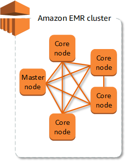
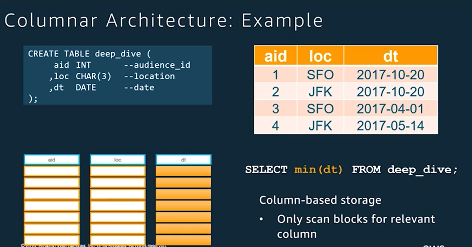

# PySpark, Spark SQL, AWS Glue, and Big Data Interview Guide

A practical reference for interview preparation

## How to Use This Guide

| Experience / goal | Focus | Be ready to show |
| --- | --- | --- |
| 6–18 months | 1–8, 20–21, 25, 36 | Correct transformations, schema/null handling, joins and deterministic results. |
| 2–4 years | 7–23, 32–38, 46 | Execution cost, skew, idempotency, table formats and pipeline recovery. |
| 5–8+ years | 22, 28, 31.5–35, 38–42, 48–52 | Trade-offs, measured incidents, consistency boundaries, migration, governance and cost. |
| Phone screen | 27 and 30 | A 30–60 second definition, example and one important limitation. |
| Online test | 4–8, 20–23 and 36 | Required function interface, exact columns/types/grain, null/tie behavior, expected output. |
| Onsite / system design | 28, 31.5–35, 38 and 52 | Clarify requirements, draw boundaries, explain failure/replay and validate your choices. |

Experience ranges are study routes, not requirements tied to years. Topics 43–45 and 47 are optional unless the role involves ML, platform ownership, serving or graphs.

**Job slow, stuck or crashed?** Start with the [recovery runbook in section 48](#48-production-debugging-and-deep-optimization); section 34 is the UI reference.

**Runtime:** Core examples use broadly available Spark 3.5+ APIs, with version-specific features called out. Glue 4.0 runs an older Spark; check section 46 before copying code. Spark 4 changes defaults such as ANSI behavior. Delta/Iceberg/Hudi and cloud connectors require compatible libraries, startup configuration and permissions. Snippets are not all standalone programs; section 4 supplies shared local data and imports.

**Answer pattern:** State the data grain and assumptions → choose an operation → explain shuffle/memory → discuss failure or edge cases → verify the result. Prefer built-ins and test nulls, duplicate keys, empty inputs, tied timestamps and retry behavior. Do not promise exact task/file counts or percentage speedups without measurements.

## Table of Contents

- [1. Big Data Fundamentals](#1-big-data-fundamentals)
- [2. Apache Spark Fundamentals](#2-apache-spark-fundamentals)
- [3. PySpark Fundamentals](#3-pyspark-fundamentals)
- [4. PySpark Desk Reference](#4-pyspark-desk-reference)
- [5. Spark SQL Tutorial](#5-spark-sql-tutorial)
- [6. DataFrame Transformations and Actions](#6-dataframe-transformations-and-actions)
- [7. Joins in PySpark](#7-joins-in-pyspark)
- [8. Partitioning and Shuffling](#8-partitioning-and-shuffling)
- [9. Spark Execution and Query Plans](#9-spark-execution-and-query-plans)
- [10. Spark Internals](#10-spark-internals)
- [11. AWS Glue Fundamentals](#11-aws-glue-fundamentals)
- [12. DynamicFrames and DataFrames](#12-dynamicframes-and-dataframes)
- [13. Reading and Writing Data](#13-reading-and-writing-data)
- [14. Data Quality and Validation](#14-data-quality-and-validation)
- [15. Error Handling and Logging](#15-error-handling-and-logging)
- [16. Spark Performance Tuning](#16-spark-performance-tuning)
- [17. Data Skew](#17-data-skew)
- [18. Caching and Persistence](#18-caching-and-persistence)
- [19. UDFs and Built-In Functions](#19-udfs-and-built-in-functions)
- [20. Window Functions](#20-window-functions)
- [21. Deduplication Patterns](#21-deduplication-patterns)
- [22. Incremental and Idempotent Processing](#22-incremental-and-idempotent-processing)
- [23. Testing PySpark Applications](#23-testing-pyspark-applications)
- [24. Production Project Structure](#24-production-project-structure)
- [25. Common PySpark Mistakes](#25-common-pyspark-mistakes)
- [26. Troubleshooting Guide](#26-troubleshooting-guide)
- [27. Interview Questions and Answers](#27-interview-questions-and-answers)
- [28. Scenario-Based Interview Practice](#28-scenario-based-interview-practice)
- [29. Frequently Used PySpark Code Snippets](#29-frequently-used-pyspark-code-snippets)
- [30. Quick Revision Sheets](#30-quick-revision-sheets)
- [31. Final Study Checklist](#31-final-study-checklist)
- [31.5. Lakehouse Architecture Fundamentals](#315-lakehouse-architecture-fundamentals)
- [32. Transactional Parquet with Delta Lake, Apache Hudi, and Apache Iceberg](#32-transactional-parquet-with-delta-lake-apache-hudi-and-apache-iceberg)
- [33. Medallion Architecture](#33-medallion-architecture)
- [34. Spark UI and Production Troubleshooting](#34-spark-ui-and-production-troubleshooting)
- [35. Explain Plan Practice](#35-explain-plan-practice)
- [36. Common Coding Interview Exercises](#36-common-coding-interview-exercises)
- [37. General Performance Anti-Patterns](#37-general-performance-anti-patterns)
- [38. Spark Structured Streaming](#38-spark-structured-streaming)
- [39. Real-Time AWS Data Pipelines](#39-real-time-aws-data-pipelines)
- [40. Data Quality, Observability, and SLAs](#40-data-quality-observability-and-slas)
- [41. Data Security and Compliance](#41-data-security-and-compliance)
- [42. Cost Optimization for Data Pipelines](#42-cost-optimization-for-data-pipelines)
- [43. Spark MLlib and Distributed Feature Engineering](#43-spark-mllib-and-distributed-feature-engineering)
- [44. Data Mesh Architecture for Big Data Platforms](#44-data-mesh-architecture-for-big-data-platforms)
- [45. Data APIs and Real-Time Serving](#45-data-apis-and-real-time-serving)
- [46. Advanced AWS Glue Patterns](#46-advanced-aws-glue-patterns)
- [47. Graph Processing and Network Analysis](#47-graph-processing-and-network-analysis)
- [48. Production Debugging and Deep Optimization](#48-production-debugging-and-deep-optimization)
- [49. Common Big Data Architecture Patterns](#49-common-big-data-architecture-patterns)
- [50. Handling Scale, Skew, and Performance Challenges](#50-handling-scale-skew-and-performance-challenges)
- [51. Modern Big Data Stack Integration](#51-modern-big-data-stack-integration)
- [52. Lakehouse Implementation & Operations Guide](#52-lakehouse-implementation--operations-guide)

## 1. Big Data Fundamentals

### What Big Data Means

Big Data describes systems where ordinary single-machine processing is not enough because the data is large, fast, complex, or operationally critical.

The common 5 Vs:

- Volume: large data size.
- Velocity: fast-arriving or frequently changing data.
- Variety: structured, semi-structured, and unstructured data.
- Veracity: data quality, trust, and consistency challenges.
- Value: business value derived from processing data.

### Distributed Computing

Distributed systems split data and work across multiple machines. Spark does this by dividing data into partitions and processing those partitions with tasks on executors.

```text
Large dataset
  -> partitions
  -> tasks
  -> executors
  -> results written or returned
```

### Visual Fundamentals

These diagrams are pulled from the repository README and are useful for quickly explaining the core Big Data mental model in interviews.

**Spark driver, executors, tasks, and slots**


Use this picture to explain that the driver plans the work, executors run tasks, and data is processed in parallel across partitions.

**EMR/Spark cluster shape**



Use this picture to connect Spark concepts to AWS: a managed/master node coordinates the cluster, and core/task nodes provide distributed compute capacity.

**Columnar storage for analytical workloads**



Use this picture to explain why Parquet/ORC-style columnar storage is efficient for analytics: queries can scan only the columns they need, which reduces I/O.

**Wide transformation: shuffle required**


Wide transformations such as `groupBy`, `join`, `distinct`, `orderBy`, and `repartition` usually require data movement across the cluster.

**Narrow transformation: no shuffle**


Narrow transformations such as `filter`, `select`, and many `withColumn` operations can process each partition independently.

### Horizontal vs Vertical Scaling

| Scaling type | Meaning | Big Data relevance |
|---|---|---|
| Vertical scaling | Use a larger machine | Simple but limited |
| Horizontal scaling | Add more machines | Core pattern for Spark and Big Data |

### Batch vs Stream Processing

Batch processing handles bounded data, such as daily files. Stream processing handles unbounded data, such as events from Kafka.

### ETL vs ELT

ETL extracts, transforms, then loads. ELT extracts, loads raw data, then transforms inside the analytical platform.

### Data Lake, Warehouse, Lakehouse

| Architecture | Description |
|---|---|
| Data lake | Object storage or distributed storage for raw and curated files |
| Data warehouse | Managed SQL analytics platform |
| Lakehouse | Data lake plus table format, transactions, and warehouse-like features |

### OLTP vs OLAP

OLTP systems support transactions. OLAP systems support analytical queries, scans, aggregations, and reporting. Spark is primarily used for OLAP and ETL workloads.

**Interview Tip**

Say: "Spark is a distributed compute engine. S3/HDFS/ADLS/GCS store bytes; Parquet defines file encoding; Delta/Hudi/Iceberg define table state; Glue Catalog stores catalog entries. Those are different layers."

## 2. Apache Spark Fundamentals

### Spark Architecture

| Component | Role |
|---|---|
| Driver | Runs application code, builds plans, schedules work |
| Executor | Runs tasks and stores shuffle/cache data |
| Cluster manager | Allocates resources, such as YARN, Kubernetes, standalone |
| Job | Work triggered by an action |
| Stage | Set of tasks separated by shuffle boundaries |
| Task | Unit of execution for one partition |
| Partition | Slice of distributed data |

### Transformations and Actions

Transformations are lazy and build a plan:

- `select`
- `filter`
- `withColumn`
- `join`
- `groupBy`
- `repartition`

Actions trigger execution:

- `count`
- `show`
- `collect`
- `take`
- `write`

### Lazy Evaluation

Spark delays execution until an action is called. This lets Catalyst optimize the full plan before running it.

```python
filtered_df = df.filter("amount > 0").select("id", "amount")  # lazy
filtered_df.count()                                           # action
```

### Narrow vs Wide Transformations

A narrow dependency lets each output partition depend on at most one input partition. A wide dependency can require redistribution across partitions. A join does not always cause a large shuffle: broadcast joins and compatible existing partitioning can avoid it.

Examples:

- Narrow: `select`, `filter`, `withColumn`
- Usually shuffle-producing: aggregations, `distinct`, `orderBy`, `repartition`, and large joins. Check the physical plan rather than assuming every occurrence shuffles.

### Shuffle

A shuffle redistributes data across executors. It uses disk, network, memory, and serialization.

**Performance Tip**

If a Spark job is slow, first look for large shuffles, skewed tasks, memory spill, and unnecessary actions.

### Lineage and Fault Recovery

Spark tracks lineage so lost partitions can be recomputed if inputs remain available. It cannot recover deleted source files or automatically undo external side effects. Cache speeds reuse; a durable checkpoint or write/read boundary can truncate lineage. One action can launch multiple jobs, and AQE can alter stage boundaries.

## 3. PySpark Fundamentals

### SparkSession and SparkContext

```python
from pyspark.sql import SparkSession

spark = SparkSession.builder.appName("tutorial").getOrCreate()
sc = spark.sparkContext
```

`SparkSession` is the primary entry point for DataFrames and SQL. `SparkContext` is the lower-level cluster connection and RDD entry point.

### DataFrames

A DataFrame is a distributed table with rows, columns, and schema.

```python
df.columns       # list of column names
df.dtypes        # list of (column_name, data_type_string)
df.schema        # StructType object with full schema metadata
df.printSchema()
df.show(5, truncate=False)
```

### RDDs

RDDs are low-level distributed collections. Use DataFrames for most PySpark ETL because DataFrames are optimized by Catalyst.

### Columns and Rows

Columns are expressions. Rows are records.

```python
from pyspark.sql import functions as F

df.select(F.col("amount") * 2)
```

### Immutability

DataFrames are immutable. Each transformation returns a new DataFrame.

```python
df2 = df.withColumn("load_ts", F.current_timestamp())
```

### Catalyst, Tungsten, AQE

- Catalyst: query optimizer.
- Tungsten: memory and CPU execution improvements.
- AQE: Adaptive Query Execution adjusts plans at runtime.

```python
spark.conf.set("spark.sql.adaptive.enabled", "true")
```

### pandas vs PySpark vs pandas API on Spark

| API | Execution and memory | Choose when |
| --- | --- | --- |
| pandas `DataFrame` | Usually eager, in one Python process | Data and working copies comfortably fit in local memory; local analysis. |
| PySpark `DataFrame` | Distributed, lazy query plan | Large scans, joins, aggregations, or a distributed pipeline. |
| pandas API on Spark (`pyspark.pandas`) | pandas-like API backed by Spark | Migrating familiar pandas operations; still inspect distributed costs. |

PySpark has no pandas-style row index or guaranteed row order. Spark joins follow SQL null semantics; pandas merge can match null keys. Check types, timestamps, nulls, and ordering when converting.

```python
import pandas as pd


pdf = pd.DataFrame({"id": [1, 2], "amount": [10.0, 20.0]})
sdf = spark.createDataFrame(pdf)  # Tiny local input copied into Spark.

# Only collect a bounded, small result for local analysis.
small_pdf = sdf.select("id", "amount").orderBy("id").limit(10).toPandas()
assert small_pdf["amount"].sum() == 30.0
```

`toPandas()` collects all selected rows to driver memory. Arrow can speed transfer, but does not remove that limit. `limit(10)` bounds row count, not the size of an individual row. `mapInPandas` and pandas UDFs run Python logic on workers; they are not the same as collecting the whole DataFrame. [Arrow/pandas reference](https://spark.apache.org/docs/3.5.7/api/python/user_guide/sql/arrow_pandas.html)


## 4. PySpark Desk Reference

### Local setup and shared practice data

Run this setup once before the core examples. They use `spark`, `F`, `Window`, and `orders` from here. Cloud/table-format examples state their extra prerequisites; snippets using names such as `fact` or `dim` assume your input DataFrames exist.

```python
from pyspark.sql import SparkSession, Window
from pyspark.sql import functions as F
from pyspark.sql.types import NumericType, StructType, StructField, StringType


spark = (SparkSession.builder.master("local[2]")
         .appName("interview-practice").getOrCreate())
spark.conf.set("spark.sql.session.timeZone", "UTC")

orders = spark.createDataFrame([
    (1, "C1", "100.00", "NEW",  "2026-01-01 09:00:00", 1),
    (1, "C1", "120.00", "PAID", "2026-01-01 10:00:00", 2),
    (2, "C1", None,     None,   "2026-01-01 11:00:00", 1),
    (3, "C2", "50.00",  "PAID", "2026-01-02 09:00:00", 1),
    (4, None, "70.00",  "NEW",  "2026-01-02 10:00:00", 1),
], "order_id long, customer_id string, amount string, status string, updated_at string, event_seq long")
orders = (orders.withColumn("amount", F.col("amount").cast("decimal(10,2)"))
          .withColumn("updated_at", F.to_timestamp("updated_at"))
          .withColumn("order_date", F.to_date("updated_at")))
```

The duplicate order 1 represents two versions; aggregate all rows only when that is the intended grain. Use section 21 to keep its latest state first.

### Inspect schema, transform, and aggregate

```python
orders.printSchema()
print(orders.columns)  # Python list of column names.
numeric_cols = [field.name for field in orders.schema.fields
                if isinstance(field.dataType, NumericType)]
# Includes decimal types; their dtype strings contain precision and scale.

paid_totals = (orders.filter(F.col("status") == "PAID")
               .groupBy("customer_id")
               .agg(F.sum("amount").alias("total")))
paid_totals.orderBy("customer_id").show()
# C1 -> 120.00; C2 -> 50.00
```

For file inputs: `spark.read.schema(schema).json(path)`, `.csv(path, header=True)`, or `.parquet(path)`. Parquet stores its schema; JSON/CSV production inputs generally need an explicit schema and malformed-record policy. Use `DecimalType` for money with a defined precision/scale; binary floating-point is approximate.

## 5. Spark SQL Tutorial

### Use SQL on a PySpark DataFrame

A temporary view gives SQL a name for a DataFrame; it does not copy, cache, or persist the data. `spark.sql()` returns another lazy Spark DataFrame for SELECT queries.

```python
orders.createOrReplaceTempView("orders")

sql_totals = spark.sql("""
    SELECT customer_id, SUM(amount) AS total
    FROM orders
    WHERE status = 'PAID'
    GROUP BY customer_id
""")
sql_totals.orderBy("customer_id").show()
# C1 -> 120.00; C2 -> 50.00

api_totals = (orders.filter(F.col("status") == "PAID")
              .groupBy("customer_id").agg(F.sum("amount").alias("total")))
```

SQL and DataFrame expressions use the same Spark SQL optimizer. Equivalent queries can produce the same plan; Python syntax alone does not make one faster. You can mix them in one pipeline.

### CTE and deterministic latest row

```python
sql_latest = spark.sql("""
    WITH ranked AS (
        SELECT *, ROW_NUMBER() OVER (
            PARTITION BY order_id
            ORDER BY updated_at DESC NULLS LAST, event_seq DESC
        ) AS rn
        FROM orders
    )
    SELECT order_id, customer_id, amount, status, updated_at, event_seq, order_date
    FROM ranked WHERE rn = 1
""")
```

`event_seq` is a source ordering field that breaks timestamp ties in this example. A local temp view is scoped to its SparkSession. A global temp view is under `global_temp` and lasts for the Spark application; neither is a durable table.

**Interview traps:** `WHERE` filters rows before grouping; `HAVING` filters aggregates. `COUNT(*)` counts rows, `COUNT(amount)` skips null amounts. SELECT queries need `ORDER BY` for guaranteed ordering. Avoid building SQL with untrusted string interpolation. DML such as `MERGE` depends on the target provider; a view over plain Parquet does not add transactions.

## 6. DataFrame Transformations and Actions

| Operation | Type | Narrow/Wide | Shuffle |
|---|---|---|---|
| `select` | Transformation | Narrow | No |
| `filter` | Transformation | Narrow | No |
| `withColumn` | Transformation | Usually narrow | Usually no |
| `drop` | Transformation | Narrow | No |
| `distinct` | Transformation | Wide | Yes |
| `groupBy(...).agg(...)` | Transformation | Usually wide | Usually; partial aggregation may happen first |
| `join` | Transformation | Usually wide | Usually yes |
| `orderBy` | Transformation | Wide | Yes |
| `repartition` | Transformation | Wide | Yes |
| `coalesce(n)` | Transformation | Narrow for DataFrame API | Reduces partitions without a full shuffle |
| `count` | Action | N/A | Executes plan |
| `collect` | Action | N/A | Executes and returns to driver |
| `show` | Action | N/A | Executes limited result |
| `take` | Action | N/A | Executes limited result |
| `write` | Action | N/A | Executes and writes |

`groupBy()` alone returns a GroupedData object; call an aggregation to produce a DataFrame. This table is a rule of thumb: Catalyst/AQE may remove or reuse exchanges. `show()` limits returned rows but its upstream aggregation/join can still scan a large dataset.

## 7. Joins in PySpark

### Join Types

```python
inner_df = left.join(right, "id", "inner")
left_df = left.join(right, "id", "left")
right_df = left.join(right, "id", "right")
outer_df = left.join(right, "id", "outer")
semi_df = left.join(right.select("id").distinct(), "id", "left_semi")
anti_df = left.join(right.select("id").distinct(), "id", "left_anti")
```

### Join Strategies

| Strategy | Use when |
|---|---|
| Broadcast hash join | One side is small |
| Sort-merge join | Both sides are large |
| Shuffle hash join | One side per partition fits memory |
| Cross join | Cartesian product is intentional |

### Avoid Ambiguous Columns

```python
joined = (
    left.alias("l")
    .join(right.alias("r"), F.col("l.id") == F.col("r.id"), "left")
    .select("l.id", "l.amount", F.col("r.segment").alias("segment"))
)
```

### Detect Join Explosion

```python
left.groupBy("id").count().filter("count > 1").orderBy(F.desc("count")).show(20)
right.groupBy("id").count().filter("count > 1").orderBy(F.desc("count")).show(20)
```

### Null keys, duplicates, and filter placement

- Two rows for a key on the left and three on the right produce six inner-join rows for that key. Deduplicate only when the business rule identifies which row to keep.
- Equality joins do not match NULL to NULL. Use `l.key.eqNullSafe(r.key)` (SQL `<=>`) only when null keys should match. Left anti joins keep unmatched left rows, including null keys under normal equality.
- A right-side filter after a left join can discard unmatched rows and make the result behave like an inner join. Filter the right input first or put that condition in `ON` to preserve left rows.
- Semi/anti joins return left columns; duplicate right keys do not multiply left rows, so `distinct()` on the right is not required for correctness.
- Broadcast must fit in executor memory after expansion, not just look small as compressed Parquet. A broadcast hint can create OOM or timeout; inspect the plan and metrics.

```python
left = spark.createDataFrame([(1,), (None,)], "id long")
right = spark.createDataFrame([(1,), (None,)], "id long")
assert left.join(right, "id", "inner").count() == 1
assert left.alias("l").join(
    right.alias("r"), F.col("l.id").eqNullSafe(F.col("r.id")), "inner"
).count() == 2
```

[Reference: Spark null semantics](https://spark.apache.org/docs/3.5.7/sql-ref-null-semantics.html)


### Plan a multi-table SQL migration before coding

The quickstart's loan-score example adds a useful habit: write the output contract first, then protect it through each join.

| Decision | Example |
| --- | --- |
| Output grain | One row per `(loan_id, as_of_date)`. |
| Driving input | Loan snapshot for the requested date, including loans without pricing. |
| Lookup grain | One selected pricing version per `(loan_id, as_of_date)`. |
| Join contract | Left join on BOTH keys; expect the driving row count only if the lookup key is unique. |
| Missing values | Keep an explicit missing-pricing flag; missing is not automatically zero. |
| Verification | Compare keys, row multiplicities, null counts and score totals with the known SQL, then scale. |

Example failure: joining two dates of pricing on loan_id alone can multiply rows and leak future prices into an earlier score. Adding distinct() afterward can hide the symptom without fixing the business rule. Begin with one complete date/key slice, retaining matching lookup rows; independent random samples can miss or invent join issues. Use full-data reconciliation before publication.

[Practice: large-table join planning](../../help/quick101-spark/spark_quickstart/spark-new-user-use-cases.md#before-you-write-pyspark-analysis-checklist).

## 8. Partitioning and Shuffling

### Runtime partitions are different from storage partitions

A Spark partition is a unit of distributed work. A directory such as `order_date=2026-01-01` is a storage layout. `write.partitionBy("order_date")` creates that layout; it does not promise one output file per date. A task may write multiple files, and multiple tasks may write to the same date.

### `coalesce` vs `repartition`

| Operation | Shuffle? | Use when | Trade-off |
| --- | --- | --- | --- |
| `df.coalesce(n)` | No full shuffle | Reduce partitions after a filter shrinks the data | Can leave uneven partitions or reduce upstream parallelism; cannot increase the current count. |
| `df.repartition(n)` | Yes | Increase parallelism or redistribute uneven data | Shuffle costs network/disk/CPU; no guarantee every partition is equal. |
| `df.repartition(n, "key")` | Yes, hash by key | Group matching keys for downstream work | A hot key still goes to one partition; this does not fix key skew. |
| `df.repartitionByRange(n, "key")` | Yes, range-based | Divide an ordered key space | Does not guarantee row order within partitions. |
| `F.coalesce(a, b)` | Not a partition operation | Pick the first non-null column value | Unrelated to `DataFrame.coalesce(n)`. |

```python
base = spark.range(100).repartition(8)
smaller = base.filter("id < 10").coalesce(2)
redistributed = base.repartition(12, "id")

assert smaller.rdd.getNumPartitions() == 2
assert redistributed.rdd.getNumPartitions() == 12
```

`.rdd` is for classic Spark; Spark Connect does not expose every RDD API. The example does not demonstrate a performance win on only 100 rows.

**Decision example:** After a large filter, reduce 1,000 partitions to a measured, smaller count with `coalesce` if balance is acceptable. For a large join with too few oversized partitions, use an appropriate shuffle partition count or repartition and inspect the plan. Do not add a redundant shuffle when the join will do one anyway.

Avoid `coalesce(1)` for large exports. It funnels work into one task and is not a general solution to small files. Catalyst can combine adjacent partition operations; inspect the executed plan rather than assuming every intermediate count is preserved. Partition counts control tasks, not exact file size. Estimate from observed bytes and benchmark; do not memorize a universal value such as 200 or 800.

`spark.sql.shuffle.partitions` sets the initial/default count for many SQL shuffles. AQE can coalesce shuffle partitions and, for supported joins, split skewed work. Table partition pruning, runtime distribution, and AQE are separate concepts.

References: [`coalesce`](https://spark.apache.org/docs/3.5.7/api/python/reference/pyspark.sql/api/pyspark.sql.DataFrame.coalesce.html), [`repartition`](https://spark.apache.org/docs/3.5.7/api/python/reference/pyspark.sql/api/pyspark.sql.DataFrame.repartition.html).

## 9. Spark Execution and Query Plans

```python
df.explain()
df.explain("formatted")
```

Look for:

| Plan marker | Meaning |
|---|---|
| `Exchange` | Shuffle or broadcast exchange |
| `Sort` | Sort operation |
| `BroadcastHashJoin` | Broadcast join |
| `SortMergeJoin` | Large equi-join |
| `HashAggregate` | Hash aggregation |
| `WholeStageCodegen` | Generated JVM code |
| `AdaptiveSparkPlan` | AQE enabled |

## 10. Spark Internals

### Catalyst

Catalyst optimizes logical plans through rule-based and cost-aware transformations.

### Tungsten

Tungsten improves memory and CPU efficiency using binary row formats and code generation.

### Py4J and Python Workers

In classic PySpark, Python builds plans through Py4J and the JVM; Spark Connect uses a client/server protocol instead. Built-in SQL expressions generally execute in the engine, not once per row in Python. Python UDFs execute in Python workers and add serialization/conversion costs.

### Arrow

Arrow enables efficient columnar transfer, especially for Pandas UDFs.

### Spill

If Spark cannot fit execution data in memory, it spills to disk. Spill is slower but prevents immediate failure.

## 11. AWS Glue Fundamentals

AWS Glue is a managed data integration service built around Spark and the Glue Data Catalog.

Core concepts:

- Glue job
- Glue version
- Worker type
- DPU
- Glue Data Catalog
- Crawler
- Job bookmark
- DynamicFrame
- GlueContext
- Connection
- CloudWatch logs
- IAM role
- Trigger/workflow

### Glue vs EMR vs Databricks vs Lambda

| Service | Best for |
|---|---|
| Glue | Serverless Spark ETL and catalog integration |
| EMR | More control over Hadoop/Spark clusters |
| Databricks | Managed lakehouse and collaborative Spark |
| Lambda | Short event-driven tasks, not large Spark ETL |

**Bookmark distinction:** A Glue bookmark tracks supported source progress for a job; it does not deduplicate target rows or make multiple writes atomic. Use stable transformation contexts and commit job state only after success. Resetting bookmarks can replay data, so the sink must handle retries/reprocessing. Catalog metadata and Lake Formation permissions are separate from the data files and table-format transaction metadata.


## 12. DynamicFrames and DataFrames

```python
from awsglue.dynamicframe import DynamicFrame

dynamic_frame = DynamicFrame.fromDF(df, glue_context, "dynamic_frame")
df = dynamic_frame.toDF()
```

DynamicFrames are useful for messy semi-structured data and Glue transforms. DataFrames are usually preferred for complex joins, aggregations, SQL, and performance.

## 13. Reading and Writing Data

### Read schema, write mode, and overwrite scope

```python
# schema and input_path describe your source; output_path is a separate destination.
source_df = spark.read.schema(schema).option("mode", "PERMISSIVE").json(input_path)
(source_df.write.mode("append").partitionBy("business_date")
 .parquet(output_path))
```

| Mode | Meaning | Common trap |
| --- | --- | --- |
| `append` | Add data files | Retrying the same batch can duplicate rows. |
| `overwrite` | Replace data under the provider's overwrite rules | Can replace the whole dataset; scope depends on provider/options. |
| `errorifexists` | Fail when destination exists | Useful to avoid accidental replacement. |
| `ignore` | Skip when destination exists | Does not validate that the existing output is correct. |

Dynamic partition overwrite replaces partitions present in the output, not every partition you intended to touch. If a delete removes every row from a partition, that partition is absent from the output and may remain unchanged. Use a transactional DELETE or explicit publication strategy instead.

Do not lazily read a Parquet path and overwrite that same path in one pipeline: Spark may delete files it still needs to read. Write to a distinct staging/version path, validate, and publish through a coordinated catalog/pointer change. Object-store directory rename is not a general atomic transaction. See section 32 for a safe local demonstration.

CSV/JSON permissive parsing is not data validation. Preserve malformed payloads in an explicit corrupt-record column or quarantine route, and check required fields after parsing. Casting malformed data can raise under ANSI mode; confirm the runtime's settings and use supported tolerant parsing functions deliberately.

## 14. Data Quality and Validation

Measure required-column nulls together rather than launching one full scan per column. A small aggregate row is appropriate to collect to the driver.

```python
required = ["order_id", "customer_id", "amount"]
profile = orders.agg(
    F.count("*").alias("rows"),
    *[F.count(F.when(F.col(name).isNull(), 1)).alias(f"{name}_nulls")
      for name in required],
).first().asDict()
assert profile["rows"] == 5
assert profile["customer_id_nulls"] == 1
assert profile["amount_nulls"] == 1
```

Also check duplicate business keys, allowed values, ranges, referential integrity, and freshness. A declared nullable=False schema is not a complete ingestion quality policy. Decide whether a failed rule blocks the batch, quarantines rows, or only alerts. For empty input, explicitly decide whether a quality ratio is undefined, acceptable, or a failure.

## 15. Error Handling and Logging

```python
import logging

logger = logging.getLogger(__name__)
logger.setLevel(logging.INFO)

def log_metric(name: str, value: object) -> None:
    logger.info("metric=%s value=%s", name, value)
```

Guidelines:

- Use structured logs.
- Log input/output paths and parameters.
- Log counts carefully because counts trigger actions.
- Catch specific exceptions when possible.
- Separate retryable and non-retryable failures.

## 16. Spark Performance Tuning

Tune from evidence, not a list of magic settings:

1. Confirm the required output grain and join cardinality. Correctness comes first.
2. Compare input bytes/file counts with the previous good run.
3. Inspect the executed SQL plan and slow stage: scan, shuffle, skew, spill, CPU, or external I/O?
4. Reduce scanned columns/partitions; replace avoidable UDFs and unnecessary actions.
5. Choose a join strategy and partition sizing that fit actual data; verify AQE's final plan.
6. Measure runtime, cost, and output equivalence after one change.

```python
spark.conf.set("spark.sql.adaptive.enabled", "true")
spark.conf.set("spark.sql.adaptive.skewJoin.enabled", "true")
spark.conf.set("spark.sql.adaptive.coalescePartitions.enabled", "true")
```

Availability and defaults vary by version and managed service. AQE is not a blanket fix and batch AQE settings should not be assumed to optimize stateful streaming queries.

**Senior follow-up:** Catalyst often pushes a filter through a simple projection or `withColumn` automatically. Reordering equivalent lines does not prove a performance improvement. Compare plans and metrics; a selective partition predicate, different join strategy, or avoided Python UDF can make a real difference.

## 17. Data Skew

Detect skew:

```python
df.groupBy("join_key").count().orderBy(F.desc("count")).show(20)

df.withColumn("pid", F.spark_partition_id()).groupBy("pid").count().orderBy(F.desc("count")).show(20)
```

Fixes:

- Broadcast small side.
- Enable AQE skew join.
- Salt hot keys.
- Split heavy hitters.
- Repartition by a better key.

Repartitioning by the same skewed key does not split that key. Salting requires a correctness-preserving rewrite on both sides of a join, or a two-stage aggregation; adding random keys on only one join side loses matches. Section 50 shows a two-stage sum.

## 18. Caching and Persistence

`cache()`/`persist()` mark a DataFrame for reuse; they do not materialize it until an action runs. `cache()` is shorthand for a default storage level (DataFrames use MEMORY_AND_DISK_DESER in Spark 3.5); `persist(level)` lets you choose. This is Spark partition caching, not Python's `functools.cache`.

```python
reused = orders.filter(F.col("customer_id").isNotNull()).cache()
try:
    reused.count()  # Optional materialization, worthwhile only if reuse justifies it.
    paid_count = reused.filter(F.col("status") == "PAID").count()
    totals = reused.groupBy("customer_id").agg(F.sum("amount").alias("total"))
    totals.show()  # Consume before unpersisting.
finally:
    reused.unpersist()
```

Cache when reuse and recomputation cost outweigh storage, serialization, and eviction costs. There is no rule that every DataFrame used three times should be cached. Cache is not a durable checkpoint and does not make a multi-step pipeline transactional. Inspect the Storage tab and InMemoryTableScan; unpersist when finished.

## 19. UDFs and Built-In Functions

Prefer SQL built-ins because Spark understands their expressions and can optimize their execution.

```python
clean = orders.withColumn("status_clean", F.upper(F.trim("status")))
```

| Option | Execution | Use |
| --- | --- | --- |
| SQL built-in / higher-order function | Engine expression | First choice; includes arrays/maps, dates, strings, JSON. |
| Python scalar UDF | Python worker; often row-oriented | Logic that cannot be expressed with built-ins. |
| pandas UDF / mapInPandas | Python worker with Arrow batches | Vectorized Python libraries; watch batch/group memory. |

Pandas UDFs are not automatically faster than built-ins. A grouped pandas operation can load an entire large/skewed group into one worker. Avoid network requests and non-idempotent side effects per row: Spark can retry tasks and execute the same effect again.

Broadcasting a small Python lookup object (`sc.broadcast`) and hinting a DataFrame broadcast join (`F.broadcast`) are different tools. Prefer joining a lookup DataFrame when the logic is relational.

## 20. Window Functions

Specify both ordering and frame semantics. A running total over rows is different from a range over equal ordering values.

```python
w = Window.partitionBy("customer_id").orderBy("updated_at", "order_id", "event_seq")
row_frame = w.rowsBetween(Window.unboundedPreceding, Window.currentRow)
result = (orders.withColumn("rn", F.row_number().over(w))
          .withColumn("previous_amount", F.lag("amount").over(w))
          .withColumn("running_total", F.sum("amount").over(row_frame)))
```

| Function / frame | Ties and meaning |
| --- | --- |
| `row_number` | One position per row; needs a total order for a reproducible winner. |
| `rank` | Tied values share a rank; gaps follow ties (1, 1, 3). |
| `dense_rank` | Tied values share a rank; no gaps (1, 1, 2). |
| `rowsBetween(-6, 0)` | Current row and six preceding rows; not seven calendar days. |
| Default ordered aggregate frame | Generally RANGE from unbounded preceding to current row; peers share the same boundary. |

For top three rows, use row_number with a tie-breaker. For top three distinct scores including ties, use dense_rank ordered only by score. Do not add a unique ID to the ranking order if ties are supposed to share a rank. A window without partitionBy can force all rows into one partition; avoid global windows on large data.

## 21. Deduplication Patterns

`distinct()` removes identical full rows. `dropDuplicates(["key"])` keeps an unspecified row for each key; it does not mean “latest.” For current-state records, define a deterministic source order.

```python
def latest_orders(df):
    w = Window.partitionBy("order_id").orderBy(
        F.col("updated_at").desc_nulls_last(), F.col("event_seq").desc_nulls_last()
    )
    return (df.filter(F.col("order_id").isNotNull())
            .withColumn("_rn", F.row_number().over(w))
            .filter(F.col("_rn") == 1).drop("_rn"))


latest = latest_orders(orders)
assert latest.count() == 4
assert latest.filter("order_id = 1").select("status").first()[0] == "PAID"
```

This assumes `(updated_at, event_seq)` uniquely orders different versions of each key. If two different payloads tie on both fields, define a source sequence or explicit conflict rule. Arrival timestamp alone does not establish business recency. Deduplication within one batch does not deduplicate against all previous batches; use an idempotent sink or MERGE for that.

## 22. Incremental and Idempotent Processing

### Incremental is not the same as idempotent

- **Incremental:** process changes since a source position, such as a CDC sequence or completed file/batch ID.
- **Idempotent:** replaying the same input has the same final effect instead of adding duplicates.
- **Event-time watermark:** bounds lateness/state in a streaming query; different from a batch high-water mark.
- **Glue bookmark:** progress tracking for supported inputs; not a target transaction.

A timestamp-only filter such as `updated_at > last_timestamp` can miss equal-timestamp rows or late commits. Use a source sequence/cursor where available, or a deliberate overlap window followed by deterministic deduplication/upsert. Preserve deletes as CDC tombstones; timestamps alone do not tell you a deleted row existed.

**Commit order:** read a bounded change range → validate/deduplicate → commit the target → record successful progress. If the sink and progress store are separate, design for the crash between those two steps through idempotent replay. For `foreachBatch`, retries can repeat a batch; a batch ID is useful only with durable deduplication scoped to the query/target.

**SCD interview follow-up:** Type 1 overwrites attributes; Type 2 retains versions with effective_from/effective_to and a current flag. Type 2 must expire the old row and insert a new row consistently, handle late changes, and ensure one current version per key. A simple update-all MERGE is Type 1, not a complete Type 2 implementation.

## 23. Testing PySpark Applications

Test transformations locally with small, explicit input and expected rows. Do not validate only row counts: wrong values can have the same count.

Save this as `test_orders.py` and run `python -m pytest test_orders.py` in an environment with pytest, a compatible PySpark/Python/Java combination, and no external cloud dependencies.

```python
import pytest
from pyspark.sql import SparkSession, functions as F


@pytest.fixture(scope="session")
def spark():
    session = SparkSession.builder.master("local[2]").appName("tests").getOrCreate()
    yield session
    session.stop()


def positive_orders(df):
    return df.filter(F.col("amount") > 0).select("id", "amount")


def test_positive_orders(spark):
    data = spark.createDataFrame([(1, 10), (2, -1), (3, None)], "id long, amount long")
    actual = [tuple(row) for row in positive_orders(data).orderBy("id").collect()]
    assert actual == [(1, 10)]
    assert positive_orders(spark.createDataFrame([], data.schema)).count() == 0
```

For joins/windows also test null keys, duplicate keys, ties, row ordering, empty inputs, and input schema. Compare DataFrames as multisets when duplicates matter: align columns/types, then check `left.exceptAll(right)` and the reverse. Test retries and late updates for lakehouse writes. Local tests do not prove cloud permissions, distributed scalability, or a streaming recovery guarantee.

## 24. Production Project Structure

Recommended structure:

```text
src/
  jobs/
  transforms/
  readers/
  writers/
  validation/
  config/
  utils/
tests/
resources/
scripts/
```

Separate I/O from transformations. Keep transformations small, testable, and reusable.

### Lessons worth taking from the quickstart

```text
Source object + stable identity → parse/type + DQ → accepted / rejected with reasons
                                               → trusted baseline → optional business transforms
```

Keep ingestion and business transforms separate when it improves replay and ownership; this does not require separate buckets or Spark applications for every step. Validate typed values as well as raw fields, preserve rejection reasons, and reconcile accepted + rejected against source rows without losing duplicate multiplicities. `subtract` has set semantics; it is not a general rejected-row accounting method.

A configuration-driven framework can separate platform code from dataset-owned schema, quality and transform rules. Validate configs/version them, use a small allowlist of supported operations, and record the config/code/run/source identities. Config files do not automatically make a pipeline idempotent or distributed.

| Quickstart resource | Best use |
| --- | --- |
| [SQL-to-PySpark examples](../../help/quick101-spark/spark_quickstart/pyspark-101-examples.md#2-sql-to-pyspark-mental-model) | Hands-on syntax practice; use the runtime and correctness notes in this guide. |
| [Ingestion architecture](../../help/quick101-spark/spark_quickstart/pyspark-ingestion-transformation-architecture.md#1-architecture-diagram) | Accepted/rejected/trusted/transformed boundaries and submission flow. |
| [Parquet layout and statistics](../../help/quick101-spark/spark_quickstart/parquet-spark-performance-and-updates.md#4-where-minmax-metadata-is-stored) | Deeper explanation of column chunks, row groups and pruning. |
| [Configuration-driven demo](../../help/quick101-spark/spark_quickstart/etl_config_driven/README.md) | A real plain-Python/local-CSV demo of ownership/config boundaries; not a distributed Spark or AWS integration test. |

The quickstart is learning material, not a production contract. Some README paths refer to a pipeline_demo folder that is not present; use the actual resources linked above. Its separate ingestion README is a design sketch with embedded snippets, not a complete deployed pipeline. LocalStack service coverage depends on version/edition; a simulated AWS response does not validate real Glue, IAM, SSM or Spark behavior.

## 25. Common PySpark Mistakes

- Using `collect()` on large data.
- Calling `count()` repeatedly.
- Using Python loops for distributed operations.
- Using Python `and`/`or` instead of `&`/`|`.
- Forgetting parentheses around column conditions.
- Using `== None` instead of `isNull()`.
- Creating ambiguous columns after joins.
- Using UDFs unnecessarily.
- Repartitioning without understanding shuffle.
- Assuming row order.
- Inferring schema in production.
- Writing too many small files.

## 26. Troubleshooting Guide

Start by classifying the job: **not submitted / queued / doing work slowly / blocked / failed / streaming and idle**. Elapsed time alone does not tell you which one it is.

1. Capture application/job-run ID, failing action, input range, code/config versions and the last good run.
2. Inspect Jobs → slow Stage → Tasks, then SQL and Executors; compare progress, task distribution and logs.
3. Find the earliest useful error on the failed driver/executor; a final Py4J or fetch error may only be a symptom.
4. Recover according to the target's commit and replay semantics, then verify output and source progress.

Use the [slow, frozen and crashed job runbook](#48-production-debugging-and-deep-optimization) for symptom-specific fixes. The [Spark UI reference](#34-spark-ui-and-production-troubleshooting) explains tabs and metrics.

## 27. Interview Questions and Answers

Answer in layers: definition → example → cost/failure case. For senior questions, add evidence and a trade-off.

### Fundamentals (roughly 6–18 months)

| Question | Concise answer |
| --- | --- |
| Why lazy evaluation? | Build a plan first, then optimize and execute it when an action needs results. |
| Driver vs executor? | Driver coordinates/plans; executors run tasks and retain task/cache data. collect/toPandas move results to the driver. |
| SQL vs DataFrame API? | Both use Spark SQL plans; choose the clearer expression and compare physical plans. |
| Is dropDuplicates latest-by-key? | No. Use row_number with a deterministic source order. |
| Does groupBy keep null keys? | Yes, null keys form a group; count(column) still skips null values. |

### Applied work (roughly 2–4 years)

| Question | Concise answer |
| --- | --- |
| Coalesce vs repartition? | Reduce without a full shuffle vs redistribute with a shuffle; distinguish task partitions from table directories. |
| Why did a left join lose rows? | Check right-side filters after the join, null keys, and output-grain assumptions. |
| How do retries avoid duplicate writes? | Stable keys/source sequences, deterministic merge/replace policy, and progress committed after target success. |
| Can Parquet UPDATE one row? | Not in place. Rewrite affected data and publish; a table format adds transactional metadata. |
| Is caching always useful? | No. It costs memory and materialization; use measured reuse and unpersist. |

### Senior design (roughly 5–8+ years)

| Question | What a strong answer includes |
| --- | --- |
| Why Delta vs Iceberg vs Hudi? | Supported engines/protocols, CDC shape, catalog/concurrency, operations, team/platform constraints. |
| What does exactly-once mean? | Define source, checkpoint/state, target commit, replay identity, and external side effects; no blanket guarantee. |
| How would you migrate a live table? | Consistent baseline + captured changes + reconciliation + coordinated cutover + rollback; row counts alone are insufficient. |
| How do you debug a slow job? | Baseline vs changed plan/data; task distribution, scan/shuffle bytes, spill, GC and retries before tuning. |
| Why lakehouse and medallion? | Table reliability vs quality/serving layers; neither automatically supplies governance, low latency, or cheap queries. |

## 28. Scenario-Based Interview Practice

Use **symptom → evidence → hypothesis → change → verification** in onsite answers.

| Scenario | Evidence and response |
| --- | --- |
| Job grows from one hour to five | Compare input/file counts, plan, join cardinality, shuffle, spill and config against the last good run. Validate output after any change. |
| One task dominates the stage | Compare max vs median task bytes/time, hot keys and spill. Consider AQE/broadcast/hot-key isolation; more workers alone may not split that task. |
| Driver OOM after an “optimization” | Look for collect/toPandas, broadcast construction, large plans or metadata; executor memory is not driver memory. |
| MERGE restores stale values | Check source ordering, timestamp ties and the matched-update guard against target sequence. |
| Backfill doubles revenue | Append was replayed, an event was counted twice, or the aggregate mixed snapshots/events; reconcile at business grain and repair idempotently. |
| Stream state grows without bound | Inspect event-time progress, watermarks, state rows and join bounds; processing-time triggers do not evict event-time state. |
| Table still contains deleted personal data physically | Logical DELETE and physical retention/backup deletion are separate concerns; coordinate table retention, active readers and organizational policy. |

Prepare one real incident answer with before/after measurements and your role. Avoid promising a fixed percentage speedup or claiming an arbitrary file size is always optimal.

## 29. Frequently Used PySpark Code Snippets

### DataFrame Comparison

Key anti joins find missing keys, not changed values. To compare full rows including duplicate counts, align column order/types first:

```python
left_rows = orders.select("order_id", "status")
right_rows = orders.select("order_id", "status")
assert left_rows.exceptAll(right_rows).isEmpty()
assert right_rows.exceptAll(left_rows).isEmpty()
```

`exceptAll` compares columns by position and retains duplicate multiplicity. `subtract` removes duplicates. For changed attributes by key, require unique keys on both inputs, full-outer join, and compare attributes with null-safe equality.

### JSON Parsing

```python
payload_schema = StructType([StructField("event_type", StringType(), True)])
parsed = df.withColumn("payload_struct", F.from_json("payload", payload_schema)).select("id", "payload_struct.*")
```

### Data Quality

```python
dq = df.agg(
    F.count("*").alias("rows"),
    F.countDistinct("id").alias("distinct_ids"),
    F.sum(F.col("id").isNull().cast("int")).alias("null_ids"),
)
```

### Glue Arguments

```python
from awsglue.utils import getResolvedOptions
import sys

args = getResolvedOptions(sys.argv, ["JOB_NAME", "input_path", "output_path"])
```

## 30. Quick Revision Sheets

### Spark Architecture

Driver builds plans and schedules tasks. Executors run tasks. Jobs are triggered by actions. Stages are separated by shuffles. Tasks process partitions.

### Performance

Filter early, select required columns, avoid unnecessary shuffles, broadcast small tables, handle skew, avoid driver collection, control file sizes, cache only reused data, inspect Spark UI.

### Join Strategies

Broadcast hash join for small-large. Sort-merge for large-large. Left anti for missing records. Left semi for existence. Check duplicate keys to avoid row explosion.

### AWS Glue

Glue is managed Spark plus Catalog. Use IAM roles, CloudWatch logs, job parameters, bookmarks/watermarks, partition pruning, and efficient S3 file layouts.

## 31. Final Study Checklist

- Explain driver, executor, job, stage, task, partition.
- Explain lazy evaluation.
- Explain narrow vs wide transformations.
- Explain shuffle.
- Explain broadcast vs sort-merge join.
- Explain repartition vs coalesce.
- Explain cache vs persist.
- Explain how to detect skew.
- Explain how to read an execution plan.
- Explain how to debug driver and executor OOM.
- Explain why plain Parquet is not transactional.
- Explain Delta Lake vs Apache Hudi vs Apache Iceberg.
- Explain bronze, silver, and gold layers in medallion architecture.
- Practice common PySpark snippets.
- Practice scenario-based answers.

## 31.5. Lakehouse Architecture Fundamentals

### Four layers to distinguish

| Layer | Example | Responsibility |
| --- | --- | --- |
| Storage | S3, ADLS, HDFS | Persist objects/blocks. |
| File format | Parquet, ORC | Encode columns, compression, row groups and statistics. |
| Table format | Delta Lake, Iceberg, Hudi | Define committed table state and supported transactional operations. |
| Catalog | Glue Catalog, Hive metastore, Unity Catalog | Resolve names/locations and integrate metadata/permissions; capabilities differ. |

A **lakehouse** uses lake storage with a table/metadata layer and query engines to provide database-like analytical tables. A **medallion architecture** organizes quality/serving layers inside a data platform. **Delta Lake** is one table format, not another name for medallion or all lakehouses.

```text
Sources → object storage + table format → catalog/query engines → consumers
                 Bronze → Silver → Gold  (optional medallion organization)
```

### Lake, warehouse, or lakehouse?

Choose based on query latency, concurrency, data shape, supported engines, team skills and total cost. Modern warehouses can also scale horizontally, stream ingest, evolve schemas and provide time travel; lakehouses are not automatically cheaper or faster. A Parquet directory is a valid dataset, but does not acquire row-level transactions just by registering it in a catalog.

Table readers use the format's metadata to find valid files/deletes. Reading `spark.read.parquet(delta_path)` bypasses the Delta log and can include obsolete or logically deleted data. Use the format-aware reader.

### Senior design decisions

- Confirm reader AND writer support for the chosen format version and optional features; “supports Iceberg/Delta” is not enough.
- Plan transaction boundaries, concurrent writers, schema evolution, record identity and retention. Table-level ACID does not imply a transaction across bronze, silver and gold.
- Governance needs IAM/storage controls and catalog policies that the engine actually enforces. A table property named owner is not an access-control rule.
- Use compaction to improve file layout; use VACUUM/cleaning/snapshot expiration to remove retained obsolete data. They solve different problems.
- Include orchestration, lineage, quality rules, monitoring and a serving strategy; the table format supplies only part of the platform.

## 32. Transactional Parquet with Delta Lake, Apache Hudi, and Apache Iceberg

### Plain Parquet CRUD: rewrite data, then publish a new version

Parquet is a columnar file format. CREATE/INSERT writes files; READ scans selected columns/row groups; UPDATE/DELETE require new data files or an external table layer. There is no generic transactional UPDATE of a standalone Parquet file.

This **local example** writes a replacement dataset to a different directory. It demonstrates row changes without overwriting files still needed by a lazy read:

```python
from pathlib import Path
from tempfile import TemporaryDirectory


with TemporaryDirectory() as directory:
    old_path = str(Path(directory) / "v1")
    new_path = str(Path(directory) / "v2")
    spark.createDataFrame([(1, "NEW"), (2, "NEW"), (3, "PAID")],
                          "id long, status string").write.parquet(old_path)

    original = spark.read.parquet(old_path)
    replacement = (original.filter(F.col("id") != 2)  # Delete id 2.
                   .withColumn("status", F.when(F.col("id") == 1, "CANCELLED")
                               .otherwise(F.col("status"))))
    replacement.write.parquet(new_path)
    actual = [tuple(row) for row in spark.read.parquet(new_path).orderBy("id").collect()]
    assert actual == [(1, "CANCELLED"), (3, "PAID")]
```

Consumers still point at v1 until a separate publication step switches them. Coordinating writers/readers, validation and recovery is your responsibility. Dynamic overwrite is not ACID and cannot infer a partition that should become empty. A cached DataFrame is not a reliable transactional publication mechanism.

### What Delta adds

Delta Lake stores data in Parquet plus a transaction log (`_delta_log`). Readers reconstruct the committed snapshot from log/checkpoint metadata and active file/deletion information. INSERT/UPDATE/DELETE/MERGE commit a new table version atomically; they do not turn Parquet files into mutable rows.

| Operation | Logical behavior | Typical physical work |
| --- | --- | --- |
| Append | Add rows | Add files and commit metadata; repeated append can duplicate input. |
| Update/delete | Change/remove selected rows | Rewrite affected files, or use supported deletion-vector features. |
| Merge | Match source rows to target keys for update/insert/delete | Read candidate target data, write changes, commit a new version. |
| Time travel | Read an older snapshot | Needs both retained metadata and referenced data/deletion files. |
| Vacuum | Physically remove eligible unreferenced data | Reduces storage but can remove the ability to read old versions. |

Deletion vectors can logically mark rows removed from Parquet without immediately rewriting the entire file; support depends on operation/runtime and protocol. Never assume every reader supports every enabled feature. [Deletion vectors](https://docs.delta.io/delta-deletion-vectors/)

### Local Delta setup (separate fresh process)

Start with a compatible Spark/Delta pair and the required Java/Python versions. For example, Delta 4.0.0 supports Spark 4.0.x; Delta 3.3.x supports Spark 3.5.x. Do not install the latest packages blindly into a managed Glue/EMR runtime. [Compatibility matrix](https://docs.delta.io/releases/)

```python
from delta import configure_spark_with_delta_pip
from delta.tables import DeltaTable
from pyspark.sql import SparkSession, functions as F


builder = (SparkSession.builder.master("local[2]").appName("delta-practice")
           .config("spark.sql.extensions", "io.delta.sql.DeltaSparkSessionExtension")
           .config("spark.sql.catalog.spark_catalog", "org.apache.spark.sql.delta.catalog.DeltaCatalog"))
spark = configure_spark_with_delta_pip(builder).getOrCreate()
```

Install the matching `pyspark` and `delta-spark` packages in a local virtual environment first; the helper resolves the JVM artifacts too. An already-running SparkSession cannot acquire startup extensions by calling getOrCreate again.

### CRUD and a stale-update-safe MERGE

Run after the Delta setup above. The version field is a monotonically increasing source sequence for each key.

```python
from pathlib import Path
from tempfile import TemporaryDirectory


with TemporaryDirectory() as directory:
    path = str(Path(directory) / "customers")
    spark.createDataFrame([(1, "Alice", 1), (2, "Bob", 1)],
                          "id long, name string, version long").write.format("delta").save(path)
    target = DeltaTable.forPath(spark, path)

    target.update(condition=F.col("id") == 2, set={"name": F.lit("Robert")})
    target.delete(F.col("id") == 2)

    # One non-null key per source batch; deduplicate by source sequence first if needed.
    updates = spark.createDataFrame([(1, "Alicia", 2), (3, "Carol", 1)],
                                   "id long, name string, version long")
    def upsert(batch):
        (target.alias("t").merge(batch.alias("s"), "t.id = s.id")
         .whenMatchedUpdateAll(condition="s.version > t.version")
         .whenNotMatchedInsertAll().execute())

    upsert(updates)
    upsert(updates)  # Replay does not create another row or regress the version.
    stale = spark.createDataFrame([(1, "Old name", 1)], updates.schema)
    upsert(stale)  # Older source version must not overwrite version 2.

    current = spark.read.format("delta").load(path)
    assert [tuple(row) for row in current.orderBy("id").collect()] == [
        (1, "Alicia", 2), (3, "Carol", 1)]
    assert spark.read.format("delta").option("versionAsOf", 0).load(path).count() == 2
```

A source batch must resolve duplicate keys/ties before MERGE, and the target must satisfy its key uniqueness invariant. A table format does not generally enforce your business primary key. Define equal-version/different-payload conflicts and null-key handling; use CDC delete operations for tombstones. For strong out-of-order delete protection, retain a versioned tombstone or equivalent state rather than allowing a stale insert to resurrect a removed key.

SQL can query a registered Delta table or a provider path, for example: ``SELECT * FROM delta.`/path/to/table` ``. UPDATE/DELETE/MERGE require Delta-enabled SQL extensions. The join of two Delta tables produces a normal lazy DataFrame; it does not update either input. [Delta DML reference](https://docs.delta.io/delta-update/)

### Concurrency and retention

Writers use optimistic concurrency: read a snapshot, prepare changes, validate and commit. Compatible writes may both succeed; conflicting writes can fail. Re-read/recompute and retry only operations designed for safe replay, with bounded backoff. Different partition directories alone are not a universal guarantee of conflict-free writes. There is no generic `.option("maxRetries", 3)` that makes all Delta operations safely retry. [Concurrency reference](https://docs.delta.io/concurrency-control/)

Do not lower retention just to save space. Account for longest readers/streams, delayed consumers, rollback needs and backups. DELETE is logical first; VACUUM later removes eligible files. With deletion vectors, physical purging can also require a supported rewrite/purge operation before those files become eligible. Compaction is separate from deletion, and reading old versions after cleanup can fail. [Maintenance reference](https://docs.delta.io/delta-utility/)

### Delta, Hudi and Iceberg

| Format | Useful capabilities to evaluate | Operational questions |
| --- | --- | --- |
| Delta Lake | Spark SQL/Python DML, log-based snapshots, change data feed | Compatible runtimes/protocols; retention, compaction and concurrent writers. |
| Hudi | Record keys, upsert/CDC, incremental consumption, copy-on-write/merge-on-read | Indexing, ordering/merge semantics, compaction/cleaning and table services. |
| Iceberg | Snapshot/manifest metadata, hidden partitioning and partition evolution, multi-engine tables | Catalog/locking, engine support for row-level changes and format versions. |

These are evaluation dimensions, not exclusive features or a universal ranking. Hudi ordering fields and behavior vary by version. Iceberg row-level changes may use copy-on-write or delete files depending on table/engine settings; snapshots do not mean rewriting the full table.

For a configured Iceberg catalog, prefer DataFrameWriterV2 and SQL DML:

```python
# Requires an existing, compatible Iceberg table and configured catalog/extensions.
updates_df.writeTo("glue_catalog.silver.orders").append()
```

Use `MERGE INTO` for upserts, and the table's partition transforms rather than guessing folder paths. A catalog named glue_catalog configured for Iceberg is not a generic Delta catalog. [Iceberg Spark writes](https://iceberg.apache.org/docs/latest/spark-writes/)

## 33. Medallion Architecture

Medallion is a quality/serving pattern, not a Spark API or table format.

```text
Sources → Bronze (source-aligned, replayable)
        → Silver (typed, validated, deduplicated, conformed)
        → Gold (business-grain marts, metrics and serving tables)
                         ↘ quarantine / audit at each validation boundary
```

| Layer | Preserve / produce | Interview example |
| --- | --- | --- |
| Bronze | Source payload, source sequence/file identity, ingestion metadata | Append captured order events; record malformed payloads for investigation. |
| Silver | Valid types/keys, deterministic versions, CDC deletes, conformed entities | One current order per ID with a monotonic source sequence. |
| Gold | Defined metric grain and business rules | Daily paid revenue by customer; do not count obsolete order versions. |

Using the local sample from section 4:

```python
# This illustrates transformations only; no transactional sink is configured here.
bronze = orders.withColumn("_source", F.lit("practice"))
silver = latest_orders(bronze)  # Function from section 21.
quarantine = silver.filter(F.col("customer_id").isNull() | F.col("amount").isNull())
valid_silver = silver.filter(F.col("customer_id").isNotNull() & F.col("amount").isNotNull())
gold = (valid_silver.filter(F.col("status") == "PAID")
        .groupBy("order_date", "customer_id")
        .agg(F.sum("amount").alias("paid_revenue")))
# Gold: 2026-01-01/C1 -> 120.00; 2026-01-02/C2 -> 50.00
```

Choose the meaning of a silver table: immutable events, current state, or SCD history. Appending every bronze replay to a “current state” silver table is not deduplication. Silver/gold often benefit from transactional formats; bronze can be raw files or transactional tables. The design does not require exactly three physical copies for every dataset.

**Senior answer:** Define freshness and quality targets, the record/event grain, replay horizon, late-change/delete handling, access policies and retention. Rebuilding gold from a current-state silver snapshot can differ from reconstructing historical metrics from events; choose deliberately. Separate table commits are not automatically atomic across layers. [Medallion reference](https://docs.databricks.com/aws/en/lakehouse/medallion)

## 34. Spark UI and Production Troubleshooting

Spark UI is the fastest way to move from guessing to evidence. In interviews, do not say only "I tune Spark." Say which UI tab you inspect and what signal you expect to find.

### Spark UI Tabs

| Tab | What to inspect | What it tells you |
|---|---|---|
| Jobs | Which action triggered execution and how long it took. | A `count`, `show`, `collect`, or write may be more expensive than expected. |
| Stages | Slow stages, task skew, shuffle read/write, spills, and retries. | One slow stage usually points to shuffle, skew, or data volume. |
| SQL | Logical/physical plans, `Exchange`, join type, scan filters, AQE changes. | Shows whether Spark is broadcasting, sorting, shuffling, or pruning. |
| Storage | Cached DataFrames/RDDs and memory usage. | Confirms whether caching helped or wasted memory. |
| Executors | Executor memory, failed tasks, GC time, input size, spill, and lost executors. | Helps diagnose OOM, skew, executor loss, and GC pressure. |
| Environment | Spark configs actually applied at runtime. | Confirms shuffle partitions, AQE, memory, serialization, and broadcast settings. |

### Troubleshooting Checklist

1. Which action triggered the job?
2. Which stage is slow?
3. Are all tasks slow, or only a few tasks?
4. Is shuffle read/write large?
5. Is there memory spill or disk spill?
6. Is GC time high?
7. Are executors failing or being lost?
8. Does the SQL plan show unexpected `Exchange`?
9. Is the join `BroadcastHashJoin`, `SortMergeJoin`, or something unexpected?
10. Are input and output file counts reasonable?
11. Are partition filters and pushed filters visible in the plan?
12. Is the job doing repeated actions such as repeated `count()`?

### Common Production Issues

| Issue | Diagnosis | Common fix |
|---|---|---|
| Executor OOM | Executors tab, container killed logs, spill metrics. | Reduce partition size, handle skew, increase memory overhead, reduce executor cores. |
| Driver OOM | Driver logs, `collect`, `toPandas`, large Python lists. | Avoid collecting large data; write results to storage; cap samples. |
| Container killed | YARN/Glue/cluster logs. | Increase memory overhead, reduce task memory pressure, reduce concurrency. |
| Lost executors | Executors tab and cluster manager logs. | Check spot loss, OOM, disk pressure, network, and shuffle pressure. |
| Task retries | Stages tab and failed task logs. | Inspect exception, input split, skew, and dependency failures. |
| Fetch failures | Shuffle read errors. | Stabilize executors, reduce shuffle size, increase retry tolerance, fix executor loss. |
| Serialization errors | Python/JVM stack traces. | Avoid non-serializable closures and large driver-side objects. |
| Schema mismatch | `AnalysisException` or read errors. | Enforce schema and validate input before processing. |
| Corrupt records | Read errors or unexpected nulls. | Use permissive mode, bad-record paths, and quarantine logic. |
| Duplicate records | Business key count greater than one. | Deduplicate with deterministic window logic. |
| Join explosion | Output much larger than expected. | Check duplicate keys on both sides before joining. |
| Data skew | A few tasks much slower than the rest. | Use AQE skew join, salting, heavy-hitter isolation, or repartitioning. |
| Small files | Many tiny output files in S3/HDFS. | Compact, coalesce/repartition before write, choose better partition columns. |
| Slow S3 scans | High file listing/scanning time. | Use Parquet, partition pruning, fewer small files, and column pruning. |
| Permission errors | `AccessDenied`, KMS, S3, or catalog failures. | Check IAM role, bucket policy, Lake Formation, KMS, and catalog permissions. |
| Missing catalog table/partition | Table lookup fails or query returns no data. | Create/update catalog metadata and partitions. |
| Dependency errors | `ModuleNotFoundError` or jar errors. | Package dependencies with the job and verify runtime versions. |
| Timeout | Job exceeds configured runtime. | Tune workers/executors, reduce scan size, fix skew, checkpoint long plans. |

## 35. Explain Plan Practice

Use `explain` when a job is slow, when a join behaves unexpectedly, or when you want to prove that Spark is pruning data.

### Basic Usage

```python
df.explain()
df.explain("formatted")
df.explain(True)
```

### Recognizing Shuffle

`Exchange` usually means Spark is redistributing data across partitions.

```python
df.groupBy("customer_id").count().explain("formatted")
```

Look for:

```text
Exchange hashpartitioning(customer_id, ...)
```

This often appears for `groupBy`, `distinct`, `orderBy`, joins, and `repartition`.

### Recognizing Join Strategy

| Plan text | Meaning | Typical use |
|---|---|---|
| `BroadcastHashJoin` | Small side is broadcast to executors. | Fast for small dimension tables. |
| `BroadcastExchange` | Spark is preparing broadcast data. | Confirm broadcast is actually happening. |
| `SortMergeJoin` | Merge matching keys in sorted inputs; existing distribution/order may be reused. | Common for large equi-joins. |
| `Exchange` before join | Data is being shuffled before the join. | Normal for large joins, expensive if avoidable. |

Example:

```python
joined = fact.join(F.broadcast(dim), "id", "left")
joined.explain("formatted")
```

### Recognizing Full Scans

If filters are not pushed down, Spark may scan more data than needed.

Check for:

```text
PushedFilters
PartitionFilters
ReadSchema
```

Good signs:

- only needed columns appear in `ReadSchema`
- partition filters are visible
- pushed filters are visible for Parquet/ORC sources

### Interview Answer Template

```text
I inspect the formatted physical plan. I look for Exchange nodes, join strategy,
partition filters, pushed filters, read schema, and AQE changes. If I see a
large sort-merge join or full scan, I reduce columns, filter earlier, broadcast
small dimensions, improve partition pruning, or tune shuffle partitions.
```

`explain("cost")` shows available estimates; `formatted` describes the physical plan. Check the executed/final AQE plan and runtime metrics in the SQL UI. A PushedFilters entry does not prove every row group was skipped. Compare actual bytes, files and rows read.

### Parquet files, task partitions and pruning

A large Parquet file is not necessarily one task or one in-memory object. Readers can split work across row groups/splits and combine small files into scan partitions. Compressed on-disk bytes also understate the decoded/execution working set.

| Mechanism | Skips / controls | Example |
| --- | --- | --- |
| Column pruning | Unused column chunks | SELECT id, amount does not require all 100 columns. |
| Storage partition pruning | Unrelated directory/table partitions | order_date = a specified day. |
| Parquet statistics | Row groups that cannot satisfy a predicate | amount max=500 lets a reader skip that group for amount > 1000. |
| Scan partition sizing | File-read task distribution | spark.sql.files.maxPartitionBytes; not an output-file-size limit. |
| maxRecordsPerFile | Row count per written file | Does not specify exact compressed MB. |

Min/max/null statistics live in Parquet metadata, commonly at row-group/column-chunk level in the footer. They do not require sorted data, but sorting/clustering can tighten ranges and improve skipping. Sorting adds write/shuffle cost and does not guarantee a later read's row order. File/row-group statistics do not replace table-format snapshots or transactions.

[Parquet format reference](https://parquet.apache.org/docs/file-format/), [Spark file scan tuning](https://spark.apache.org/docs/3.5.7/sql-performance-tuning.html#other-configuration-options).

## 36. Common Coding Interview Exercises

Use the shared data from section 4. Return the required columns/types and apply orderBy only when the task requires output order. These examples use tiny collections for assertions; do not collect production datasets.

### Latest row and top N

Use `latest_orders` from section 21 for current order state. For exactly one most recent order per customer, break timestamp ties with the unique order ID:

```python
latest = latest_orders(orders)
w = Window.partitionBy("customer_id").orderBy(F.col("updated_at").desc(), "order_id")
top_one = latest.withColumn("rn", F.row_number().over(w)).filter("rn = 1").drop("rn")
```

Clarify whether null customer IDs are a valid group. For top N distinct amounts including ties, use dense_rank ordered only by amount; do not add ID to that rank order.

### Missing IDs: anti join

```python
expected_ids = spark.createDataFrame([(1,), (2,), (3,), (9,)], "order_id long")
missing = expected_ids.join(latest.select("order_id"), "order_id", "left_anti")
assert [row.order_id for row in missing.collect()] == [9]
```

### Changes by key, including null values

```python
before = spark.createDataFrame([(1, "NEW"), (2, None)], "id long, status string")
after = spark.createDataFrame([(1, "PAID"), (2, "NEW")], before.schema)
changed = (before.alias("b").join(after.alias("a"), "id")
           .filter(~F.col("b.status").eqNullSafe(F.col("a.status")))
           .select("id", F.col("a.status").alias("status")))
assert changed.count() == 2
```

This example detects updates for matching keys. Use a full outer join plus presence flags to classify inserts/deletes too; require unique non-null keys or define another matching policy.

### Union, duplicates and schema order

```python
left = spark.createDataFrame([(1, "x")], "id long, label string")
right = spark.createDataFrame([("y", 2)], "label string, id long")
combined = left.unionByName(right)  # union() would match by position.
assert [tuple(row) for row in combined.orderBy("id").collect()] == [(1, "x"), (2, "y")]
```

Both union methods retain duplicates; call distinct only if the contract requires it. allowMissingColumns=True fills missing columns with nulls and should be a deliberate schema policy.

### Explode arrays without losing empty/null parents

```python
nested = spark.createDataFrame([(1, ["a", "b"]), (2, []), (3, None)],
                               "id long, tags array<string>")
flat = nested.select("id", F.explode_outer("tags").alias("tag"))
assert flat.count() == 4  # a, b, one null for empty array, one null for null array.
```

Use explode when empty/null arrays should produce no output rows. For JSON text, use from_json with an explicit schema before selecting nested fields.

### Running total and rolling average

```python
w = Window.partitionBy("customer_id").orderBy("updated_at", "order_id")
running = latest.withColumn("total", F.sum("amount").over(
    w.rowsBetween(Window.unboundedPreceding, Window.currentRow)))
last_three = latest.withColumn("avg_last_3_rows", F.avg("amount").over(w.rowsBetween(-2, 0)))
```

A row frame counts rows, not elapsed days. For a time-range window, define event time, time zone, peer/tie behavior and missing-day handling first. Aggregates ignore null amounts; decide if null means unknown or zero before filling it.

### Null semantics and counts

```python
counts = orders.agg(F.count("*").alias("rows"), F.count("amount").alias("known_amounts")).first()
assert (counts.rows, counts.known_amounts) == (5, 4)
assert orders.filter(F.col("status") != "PAID").count() == 2  # NULL status is not kept.
keep_unknown = orders.filter((F.col("status") != "PAID") | F.col("status").isNull())
assert keep_unknown.count() == 3
```

Do not translate pandas truth tests directly into Spark Column expressions. Use parenthesized `&`, `|`, `~`, isNull/isNotNull, and literal columns where appropriate.

## 37. General Performance Anti-Patterns

These are common review findings in Spark and Glue code. They apply broadly to production data pipelines.

| Anti-pattern | Why it hurts | Better pattern |
|---|---|---|
| Collecting partition keys to the driver | Driver memory risk and serial metadata calls. | Use batch APIs, partition projection, controlled repair, or bounded collection. |
| Reading credentials from local files | Unsafe and hard to deploy. | Use IAM roles, profiles for local testing, and environment-based configuration. |
| Using gzip for frequently queried Parquet | Smaller files but slower CPU-heavy analytics. | Prefer Snappy for balanced Spark read/write performance. |
| Repeated `count()` actions | Each count can trigger a full job. | Persist reused intermediates and make metrics intentional. |
| Large `toPandas()` calls | Moves data to driver memory. | Limit strictly, select only report columns, or write sample output to storage. |
| Very long SQL/DataFrame chains | Large logical plans and expensive retries. | Checkpoint or materialize at safe boundaries. |
| Python UDFs for simple logic | Blocks optimization and adds serialization overhead. | Use built-in functions or SQL expressions. |
| Repeated `withColumn` chains | Can create large plans when generated dynamically. | Use one `select` for many derived columns. |
| Partitioning by high-cardinality columns | Creates too many directories/files. | Partition by date or low/medium-cardinality query columns. |
| Ignoring small files | Slow listing and scheduling overhead. | Compact files and target healthy file sizes. |
| Joining without checking key uniqueness | Can multiply rows unexpectedly. | Count duplicate keys before joining. |
| Repartitioning blindly | Causes unnecessary shuffle or bad parallelism. | Repartition based on data size, keys, and downstream operation. |

### Practical Review Checklist

1. Are inputs filtered and columns selected early?
2. Are schemas explicit?
3. Are joins using the right keys and join type?
4. Are duplicate keys checked before joins?
5. Is the small side broadcast when appropriate?
6. Are high-volume actions such as `count()` intentional?
7. Is anything collected to the driver?
8. Are UDFs avoidable?
9. Are output file sizes reasonable?
10. Are partition columns aligned to common filters?
11. Is the job idempotent for retries?
12. Are logs, metrics, and data quality checks sufficient?

## 38. Spark Structured Streaming

### Model and a valid trigger

Structured Streaming evaluates a DataFrame query incrementally over an unbounded input. Micro-batches are the common execution mode; a batch can create multiple Spark jobs/stages. Output mode, state support and sink capabilities must agree.

```python
# Assumes an existing event stream with event_ts TIMESTAMP, customer_id and amount.
windowed = (events.withWatermark("event_ts", "10 minutes")
            .groupBy(F.window("event_ts", "5 minutes"), "customer_id")
            .agg(F.sum("amount").alias("total")))

# Requires a Delta-enabled runtime and separate durable target/checkpoint paths.
query = (windowed.writeStream.format("delta").outputMode("append")
         .option("checkpointLocation", checkpoint_path)
         .trigger(processingTime="10 seconds")
         .start(output_path))
```

Append mode emits finalized event-time windows after watermark progress. Without a watermark, an unbounded aggregation may not be valid in append mode. Update/complete modes have different sink and state requirements.

| Trigger | Meaning |
| --- | --- |
| No trigger option | Run successive micro-batches as fast as possible. |
| processingTime="10 seconds" | Start on that interval when able; a slow batch does not guarantee ten-second freshness. |
| availableNow=True | Process data available at the start, in one or more batches, then stop (supported sources). |
| continuous="1 second" | Different, restricted continuous mode; do not assume micro-batch state/operators or exactly-once guarantees. |

### Watermarks: event time, not a wall-clock TTL

Conceptually, watermark progress is based on the maximum observed event time minus the delay threshold. If max event time is 14:10 and the delay is ten minutes, the watermark is around 14:00, not “accept everything before 14:00.” Rows older than that may be too late. The guarantee is one-sided: data within the supported delay is not dropped for lateness; data beyond it may or may not be processed.

Eviction depends on operator/window/join conditions and trigger progress. A ten-minute watermark does not imply exactly ten minutes of state, and an idle source may stop watermark advancement. Multiple input streams have a watermark policy too.

### Recovery and end-to-end guarantees

A checkpoint holds source progress, commit metadata and, for stateful queries, state-store information. It is not the output sink's `_spark_metadata` directory. Assign a stable, unique durable checkpoint to each query; changing stateful logic or source layout can require migration/restart planning.

| Boundary | What must be true |
| --- | --- |
| Source | Replayable offsets/files retained long enough. |
| Processing | Recoverable checkpoint/state and replay-safe logic. |
| Sink | Transactional or idempotent writes for replayed batches. |
| External effects | Separate deduplication/transaction handling for notifications, APIs, JDBC writes, etc. |

foreachBatch supplies a batch ID but is at-least-once by default; implement durable replay protection. Kafka sink writes are at-least-once. A checkpoint alone does not make arbitrary sinks exactly-once.

### Joins and state

Stream-static joins can enrich a stream without retaining both streaming sides as state. Broadcast the static side only when it fits. Refresh strategy and historical consistency need explicit design; a static DataFrame is not automatically a continuously refreshed dimension.

Stream-stream joins need event-time watermarks AND bounded event-time join conditions for bounded state. Joining only on user_id does not magically retain “one hour.” Stateful deduplication also needs a defined key and retention horizon; on supporting runtimes use dropDuplicatesWithinWatermark deliberately.

**Operate:** Track query progress (input/processed rows per second, batch duration, watermark and state rows), source lag and sink latency. Test restarts, duplicated inputs, late events and malformed records. Do not assume batch AQE settings tune stateful streaming.

[Reference: Structured Streaming](https://spark.apache.org/docs/3.5.7/structured-streaming-programming-guide.html)

## 39. Real-Time AWS Data Pipelines

### Pick the ingestion boundary

| Service | Role | Interview trade-off |
| --- | --- | --- |
| Kinesis Data Streams / Kafka | Retained event stream | Ordering is per shard/partition; replay, key skew and retention matter. |
| Amazon Data Firehose | Managed buffered delivery | Lower operational burden; delivery/format/latency capabilities depend on destination. |
| Glue Streaming | Managed Spark processing | Choose supported connector/options, worker capacity, checkpoint and sink replay policy. |
| EventBridge + Step Functions | Routing and orchestration | Events can repeat; define execution identity and idempotent jobs. |

```text
Kafka/Kinesis → supported streaming connector → parse/quarantine → Bronze table
                                              → Silver upsert → Gold → compatible query/serving engine
S3 object event → EventBridge → workflow/Lambda → Glue job → validation/publication
```

Kinesis is not a universal built-in `.readStream.kafka(...)`-style API. Connector names/options and record schemas vary between open-source Spark, EMR and Glue. Use the runtime's supported connector, not invented shorthand. For GlueContext, construct it from SparkContext (for example `GlueContext(spark.sparkContext)`), not SparkSession.

An EventBridge rule needs a supported target integration. Use a documented Glue workflow/event trigger, or invoke a workflow/Lambda that starts the job; do not assume a Glue job ARN is directly interchangeable with any EventBridge target. Size workers from measured throughput/lag, not a blanket “always G.2X” rule.

### Submission success is not job success

In an S3 → Lambda → SSM → spark-submit design, Lambda is a short-lived submitter; keep long-running Spark processing outside the invocation. Record the SSM command ID and the Spark application/job-run ID, then track completion through the owning service. An accepted command can still queue, fail to launch, or fail during the write.

S3 events can repeat. Use a deliberate source identity (for example bucket/key/version plus pipeline identity), coordinate concurrent runs, and make replay safe. A new random run ID is useful for tracing but does not deduplicate a repeated source event. Keep input validation and argument passing separate from shell command construction.

## 40. Data Quality, Observability, and SLAs

### Quality, freshness and correctness are different

| Metric | Define it precisely |
| --- | --- |
| Completeness | Non-null required values / eligible rows; define empty-input behavior. |
| Uniqueness | Rows or keys meeting the uniqueness rule; specify denominator. |
| Validity | Values satisfy format/range/domain rules; a valid email pattern does not prove accuracy. |
| Accuracy | Reconcile with a trusted source or business truth. |
| Freshness | Age of newest committed source/target data, including source outages. |
| Timeliness | Data delivered by a specified deadline in a specified time zone. |

An SLI is the measured indicator, an SLO its target, and an SLA a stated service commitment. No bronze/silver/gold percentage is inherently guaranteed.

### Validate all required columns, including non-first columns

```python
def validate_orders(df):
    required = ["order_id", "customer_id", "amount"]
    missing = set(required) - set(df.columns)
    if missing:
        raise ValueError(f"Missing columns: {sorted(missing)}")
    nulls = df.agg(*[F.count(F.when(F.col(name).isNull(), 1)).alias(name)
                     for name in required]).first().asDict()
    if any(nulls.values()):
        raise ValueError(f"Null required values: {nulls}")
    if not df.groupBy("order_id").count().filter("count > 1").isEmpty():
        raise ValueError("Duplicate order IDs")
    if not df.filter(F.col("amount") < 0).isEmpty():
        raise ValueError("Negative amount")
    return df
```

This illustrative contract permits zero amounts and empty batches. Change those rules to the domain. Define quality failures before publishing, retain quarantined rows with reasons, and reconcile source/accepted/rejected counts. Collecting one aggregate row is bounded; converting the entire dataset to pandas for validation is not.

Use native Spark aggregates or a version-compatible Spark quality framework. Great Expectations APIs differ by release; configure a Spark-backed data source rather than copying obsolete pandas-only APIs into a large-data job.

**Senior follow-up:** Verify schema types as well as column names/nullability; monitor freshness even when no new rows arrive. Anomaly scores need a historical baseline and a defined behavior for zero variance/empty history; they are not a correctness proof.

## 41. Data Security and Compliance

### Enforce access at the boundary

- IAM/bucket/KMS policies protect storage; catalog/Lake Formation/Unity Catalog controls apply only through supported engines and configured policies.
- Filtering a DataFrame or dropping a column is a transformation, not an access-control boundary if the caller can read the underlying files.
- Row filters and column masks are provider-specific. Unity Catalog SQL is not generic Spark SQL and does not configure Glue Catalog permissions.
- An unsalted SHA-256 of a predictable identifier is pseudonymization, not encryption or guaranteed anonymity. Use approved tokenization/keyed hashing where required, and protect the mapping/key.

For a data-processing example only:

```python
masked = orders.select("order_id", F.lit("REDACTED").alias("customer_id"), "amount")
```

Encryption must be configured on the storage connector/runtime or bucket, not assumed from arbitrary DataFrameWriter options. Use workload IAM roles and secret stores, TLS where supported, and verify actual object encryption and KMS permissions. Never embed passwords in examples intended for deployment.

### Logical deletion vs physical removal

A table DELETE removes rows from the current snapshot. Old data files, snapshots, checkpoints, downstream exports and backups may still retain them. Design authorized retention/physical cleanup and audit workflows across all copies. A region setting or a short Spark script does not establish legal compliance. Keep this as an engineering discussion, with policy requirements supplied by the organization.

Log access and policy decisions in the enforcing systems, with request/job/table identities; avoid exposing sensitive payloads in logs. Distinguish a self-reported application log from an authoritative storage/catalog audit trail.

## 42. Cost Optimization for Data Pipelines

Optimize **cost per correct, on-time output**, not just executor runtime.

```text
Compute cost ≈ billed capacity × billed duration × applicable regional rate
Total cost = compute + storage over time + requests + data transfer + orchestration/maintenance
```

Storage charges are not a per-GB-read price. Glue DPU-hours are not executor-hours. Use the workload's billing units, region, execution class and measured utilization; avoid copying fixed prices into interview answers.

### Right-sizing and layout

| Symptom | Candidate action | Verify |
| --- | --- | --- |
| Many tiny files / scheduling overhead | Compaction or better write distribution | File-count/size distribution and scan latency. |
| Large spills / OOM | Smaller per-task data, less skew, appropriate worker/memory sizing | Spill, GC, task bytes and cost. |
| Mostly idle workers | Lower capacity or supported autoscaling | SLA, peak lag and billed capacity. |
| Repeated expensive scans | Selective layout/filtering or justified cache | Actual bytes scanned, reuse and memory pressure. |
| Heavy shuffle | Correct cardinality, broadcast if safe, partial aggregation | Final plan, shuffle bytes and output equality. |

Executor memory/instances are generally startup/resource-allocation settings; setting them on an already-running SparkSession does not resize the cluster. Glue uses worker types and worker counts/autoscaling. Choose from its actual runtime-supported options.

Catalyst can push filters through equivalent projections, so merely moving a filter up a chain may produce the same scan. Verify PartitionFilters/ReadSchema and actual I/O. Compaction and retention also incur costs; choose frequency from write/read volume and operational requirements.

Use current service pricing and measured job metrics for estimates. A table format does not impose a universal dollar-per-TB premium, and a lakehouse is not automatically cheaper than a warehouse.

## 43. Spark MLlib and Distributed Feature Engineering

Use `pyspark.ml` DataFrame pipelines for distributed feature preparation and supported models. Distributed training is not automatically preferable just because data originated in Spark.

```python
from pyspark.ml import Pipeline
from pyspark.ml.classification import LogisticRegression
from pyspark.ml.feature import StringIndexer, OneHotEncoder, VectorAssembler


# training and validation have region STRING, amount DOUBLE, label DOUBLE.
indexer = StringIndexer(inputCol="region", outputCol="region_index", handleInvalid="keep")
encoder = OneHotEncoder(inputCol="region_index", outputCol="region_vector")
assembler = VectorAssembler(inputCols=["amount", "region_vector"], outputCol="features")
classifier = LogisticRegression(featuresCol="features", labelCol="label")
pipeline = Pipeline(stages=[indexer, encoder, assembler, classifier])
# fitted = pipeline.fit(training)
# predictions = fitted.transform(validation)
```

Split before fitting preprocessors to avoid leakage. Fit on training only, reuse the same fitted PipelineModel for validation/scoring, define null/unseen-category behavior, and persist model/version metadata. For event data, use a time-aware split and point-in-time-correct joins so features do not see future information.

Feature stores add feature definitions, lineage and online/offline serving contracts; writing a Delta file alone is not a complete feature store. Choose distributed training versus bounded export to another ML stack using working-set size, supported algorithms and serving needs.

## 44. Data Mesh Architecture for Big Data Platforms

Data mesh is primarily an ownership and operating model: domains own data products, a self-service platform provides reusable infrastructure, and federated governance sets interoperable standards.

| Pillar | Practical evidence |
| --- | --- |
| Domain ownership | Named team responsible for quality, changes and incidents. |
| Data as a product | Defined schema/grain, consumers, documentation, versioning and SLOs. |
| Self-service platform | Standard ingestion, CI/CD, catalog, observability and permissions. |
| Federated governance | Shared identity, contracts, interoperability and enforcement policies. |

A medallion lakehouse can be organized per domain, but creating three folders per team does not create a data mesh. Catalog registration alone does not provide ownership, lineage or quality enforcement. For senior interviews, discuss who owns cross-domain definitions, incompatible schema changes, access approvals and incident response.

## 45. Data APIs and Real-Time Serving

Separate bulk analytics from low-latency serving:

```text
Spark gold tables → incremental export/materialization → database/search/online store
                                                API → bounded lookups/cache
Spark SQL warehouse / Athena / Trino → BI and interactive analytics
```

Starting a Spark scan per Flask request is usually a poor sub-second API design: scheduling, concurrency and driver memory become request-path bottlenecks. A cache may hide repeated queries but does not fix unbounded misses. Select serving storage and indexes for the latency/concurrency/SLA required, then publish consistent versions with refresh lag monitoring.

For a deliberate batch export, use compatible schema/format/catalog integration and idempotent publication. Registering a path does not create an Athena-specific transaction layer, and reading a Delta path as raw Parquet bypasses its snapshot semantics. Serializing Spark Rows uses `row.asDict()`, not `dict(row)`.

## 46. Advanced AWS Glue Patterns

### Runtime compatibility comes before APIs

| Glue runtime | Spark | Python | Java |
| --- | --- | --- | --- |
| Glue 4.0 | 3.3.0 | 3.10 | 8 |
| Glue 5.0 | 3.5.4 | 3.11 | 17 |

These are named runtime examples, not a claim about the newest release. Verify the job's selected version and bundled table-format libraries before deploying. Do not assume local Spark 4 APIs or Delta 4 packages work in Glue 4/5. [Glue runtime matrix](https://docs.aws.amazon.com/glue/latest/dg/release-notes.html)

| Worker example | DPU | vCPU | Memory |
| --- | --- | --- | --- |
| G.1X | 1 | 4 | 16 GB |
| G.2X | 2 | 8 | 32 GB |
| G.4X | 4 | 16 | 64 GB |

Other sizes and memory-optimized options depend on availability/runtime. Choose capacity using task memory and throughput, not just input GB. [Worker specifications](https://docs.aws.amazon.com/glue/latest/dg/worker-types.html)

### Glue job lifecycle sketch

```python
import sys
from awsglue.context import GlueContext
from awsglue.job import Job
from awsglue.utils import getResolvedOptions
from pyspark.context import SparkContext


args = getResolvedOptions(sys.argv, ["JOB_NAME"])
glue_context = GlueContext(SparkContext.getOrCreate())
spark = glue_context.spark_session
job = Job(glue_context)
job.init(args["JOB_NAME"], args)
# Perform input/transformation/output work here; propagate failures.
job.commit()  # Commits bookmark progress where configured; not arbitrary sink transactions.
```

Configure table-format support using the selected Glue runtime's documented job parameters/JARs/extensions, rather than mixing session builders for multiple formats. Iceberg GlueCatalog uses its catalog implementation and S3 FileIO; `catalog.type=glue` is not a portable substitute. Use documented integration for each format: [Delta on Glue](https://docs.aws.amazon.com/glue/latest/dg/aws-glue-programming-etl-format-delta-lake.html), [Iceberg on Glue](https://docs.aws.amazon.com/glue/latest/dg/aws-glue-programming-etl-format-iceberg.html).

Glue Studio can generate code, but production jobs still need version control, tests, observability and retries. JDBC reads need a compatible driver, bounded parallelism and database-load protection; avoid collecting secrets or blindly maximizing connections.

## 47. Graph Processing and Network Analysis

GraphFrames supplies DataFrame-based graph algorithms as an additional dependency; match its Python/JVM artifacts to Spark/Scala. Vertices require a unique id column, edges src/dst, and some algorithms require a configured checkpoint location.

```python
# Requires compatible GraphFrames packages/JARs and an initialized SparkSession.
from graphframes import GraphFrame


vertices = spark.createDataFrame([(1,), (2,), (3,)], "id long")
edges = spark.createDataFrame([(1, 2), (2, 3)], "src long, dst long")
graph = GraphFrame(vertices, edges)
graph.degrees.show()  # Total degree; use inDegrees/outDegrees when direction matters.
```

Connected components find connectivity, not necessarily communities or fraud rings. For component membership, join returned vertex IDs/component labels to your entities; a component label is not a list for isin(). Directed shortestPaths to landmarks and PageRank have different meanings; explain the algorithm before choosing it.

In interviews, discuss edge/vertex cardinality, high-degree skew, iterations, checkpointing and whether a graph database or specialized engine better fits online traversal. Treat fraud signals as candidates requiring validation, not proof.

## 48. Production Debugging and Deep Optimization

### 1. Capture evidence before restarting

Record the application/job-run ID, action/query, start time, input range/size/file count, code/config versions and last successful run. Save the first useful exception plus driver/executor/container logs. Compare input, completed tasks and streaming progress over time; a busy notebook cell is not proof that Spark is frozen.

For a healthy **classic Spark** driver, this snapshot reads scheduler state without triggering a new data scan:

```python
sc = spark.sparkContext
tracker = sc.statusTracker()
print("application:", sc.applicationId)
print("UI:", sc.uiWebUrl)  # May be None when UI is disabled.
print("active jobs:", tracker.getActiveJobsIds())
print("active stages:", tracker.getActiveStageIds())
```

The snapshot is best-effort and can change immediately. Spark Connect/managed notebooks may expose different controls. If the driver is unreachable, use the cluster/service console and retained logs instead of adding another count/collect action.

### 2. Locate the phase: slow vs blocked vs waiting

| Evidence | Investigate | Candidate fix |
| --- | --- | --- |
| No app ID, or failure before first Spark job | Launcher logs, Python/Java/Spark/JAR versions, credentials/DNS and source/catalog discovery | Fix launch/config/connectivity; adding executors cannot fix an incompatible runtime. |
| App exists; pending tasks, no usable executors | Queue/quota/capacity, executor startup failures, resource requests and autoscaling limits | Resolve allocation/startup; distinguish queued work from a hung task. |
| No active stage while driver is busy | File listing, schema inference, large plan construction, Python loops or driver-side calls | Narrow paths/schema, reduce plan growth; inspect the driver's thread stack when authorized. Lazy transformations alone may submit no work. |
| One/few tasks dominate | Max vs median bytes/time, hot keys, spill, task host, Python/UDF stack | Correct skew/cardinality, split oversized work, or fix blocked code. Extra workers alone do not split a hot key. |
| All tasks progress, but slowly | Total scan/shuffle bytes, CPU, disk spill/GC and join output size | Reduce actual work, fix join explosion/layout, size task working sets; measure output equivalence. |
| Active tasks stop making progress | JVM/Python stacks, external JDBC/API/S3 waits, retries and GC | Fix the specific dependency/code; set bounded connector/client timeouts, not arbitrary Spark-wide timeout increases. |
| Tasks finish but write has not returned | Driver/connector commit logs, catalog/table locks/conflicts, uploads and external sink status | Diagnose finalization; verify committed target state before retrying. Do not race another writer against it. |
| Stream is RUNNING with no new output | Source lag, input/processed rates, trigger duration, last progress, watermark/state and sink | Idle input or unfinalized windows can be normal. Growing lag with stalled batches points to processing/sink pressure. |

A stream's runtime is not a batch completion deadline. For micro-batches, compare source lag and processed throughput with the required freshness; do not restart simply because an awaitTermination call keeps waiting.

### 3. If it crashed, find which process failed

| Failure / symptom | Evidence and correction |
| --- | --- |
| Driver OOM or vanished driver | Remove unbounded collect/toPandas, huge local objects/plans/metadata; size the driver separately from executors. A final Py4J connection error alone does not prove OOM. |
| Executor/container killed | Check the platform termination reason and memory metrics. Exit 137 means SIGKILL, not automatically OOM. Distinguish JVM heap from Python/native/off-heap/container overhead; reduce per-task pressure or choose appropriate capacity. |
| Python worker exits or hangs | Inspect Python traceback/stderr, package/ABI/Python versions, UDF input size and external calls. Reproduce with the offending partition/key, then prefer built-ins or bounded logic. |
| FetchFailed / repeated executor loss | Trace lost shuffle data to OOM, disk, network or preemption. Fix the underlying loss; increasing retries can mask the cause and prolong failure. |
| AnalysisException / NoSuchMethodError / missing module | Fix schema/column/API or package/JAR compatibility. Repeating the same invalid plan will not recover it. |
| One partition repeatedly fails | Isolate a bounded input/key range and check malformed values, deterministic exceptions, large records or skew; keep a regression case. |

Speculation may help certain stragglers, but it is not a general fix for data skew or deterministic failures, and duplicate task attempts can repeat external side effects. Spill is sometimes normal; use its size and impact, not its mere presence, to diagnose memory pressure.

### 4. Cancel and recover without duplicating work

1. Preserve diagnostics and identify concurrent writers/runs. If work must stop, cancel the specific job/query through its owning interface.
2. In classic Spark, a job group assigned before the action can be cancelled with `sc.cancelJobGroup(group_id)` from another driver control path. This is best-effort cancellation, not a guaranteed kill of every external call or an undo of writes. For streaming, stop the query with its query control; stopping SparkSession affects the whole application.
3. Check target commit history/output manifests and source progress. Some writes may have committed before the driver failed; a timeout does not prove that nothing was written.
4. Retry a bounded source range using the target's replay-safe merge/replace policy. Repeated plain append can duplicate data. Do not delete a stream checkpoint, transactional metadata, or shared output merely to make a retry start.
5. Confirm keys/multiplicities, business totals, rejected rows, freshness/lag and progress state; then add the failure case to tests/alerts.

**Example:** A stage has 199 completed tasks and one task with 30× the median input. Investigate the hot key and join multiplicity first. If instead no executors were allocated, fix capacity/launch. If a JDBC write committed before the driver died, reconcile that commit before replaying it. The same “job took too long” symptom leads to different fixes.

### 5. Make the next incident easier to diagnose

Enable retained event logs before startup so History Server or the platform's Spark UI can reconstruct completed/failed runs. Logs need an existing, writable, supported location; driver text logs and Spark event logs serve different purposes. On Glue, configure Spark UI/event-log storage and retain the job-run/CloudWatch identifiers. Event-log parsing varies by Spark version; an executor metrics update is not an executor failure event.

Log phase boundaries and correlated run/app/query IDs. Monitor task skew, retries, spill/GC, executor loss, source lag and commit duration. Keep dependency timeouts and bounded orchestration retries aligned with the SLA; avoid launching overlapping retries before earlier attempts stop.

References: [Spark monitoring and history](https://spark.apache.org/docs/3.5.7/monitoring.html), [Spark cancellation](https://spark.apache.org/docs/3.5.7/api/python/reference/api/pyspark.SparkContext.cancelJobGroup.html), [Glue Spark UI/history](https://docs.aws.amazon.com/glue/latest/dg/monitor-spark-ui-history.html), [Glue capacity diagnosis](https://docs.aws.amazon.com/glue/latest/dg/monitor-debug-capacity.html).

## 49. Common Big Data Architecture Patterns

| Pattern | Structure | Key trade-off |
| --- | --- | --- |
| Lambda architecture | Separate batch and speed processing feeding serving views | Two implementations must reconcile consistently; naïve union can double-count overlap. |
| Kappa architecture | Durable event log with stream processing and replay | Replay cost, retention and historical corrections must fit the design. |
| Medallion lakehouse | Bronze/silver/gold on lake/table storage | Layer contracts, versioned publication and reprocessing; not inherently real-time. |
| Data mesh | Domain-owned products on a shared platform | Ownership/governance/interoperability, not a replacement storage format. |

Choose from freshness, correction/replay needs, source retention, query engines and team operations. None requires coalesce(1), unconditional append, or an unbounded stream-stream join. Avoid “one architecture always wins” answers.

## 50. Handling Scale, Skew, and Performance Challenges

### Salting an aggregation correctly

For a hot key, a two-stage aggregation can spread partial sums. Keep salt bucket count bounded and remove the salt in the final grouping.

```python
# Assumes transactions has customer_id STRING and amount numeric.
salted = transactions.withColumn("_salt", F.floor(F.rand(seed=7) * 8).cast("int"))
partial = salted.groupBy("customer_id", "_salt").agg(F.sum("amount").alias("partial_sum"))
totals = partial.groupBy("customer_id").agg(F.sum("partial_sum").alias("total"))
```

A seeded random expression is not a durable row identity across repartitioning/retries; use a stable hash of a source record ID if repeatable assignment is needed. For exact money sums, use suitable decimal precision. Floating-point regrouping can change rounding. For averages, combine partial sum AND count, not an average of averages.

For joins, replicate the small hot-key side across salts and assign each corresponding large-side row one salt; implement null and outer-join semantics deliberately. Repartitioning on customer_id alone leaves the hot key intact. Identify heavy-hitter DataFrames through semi/anti joins, not `col.isin(other_dataframe)`.

### Scale and lineage

File count, metadata overhead, skew and shuffle bytes matter as much as total TB. There is no correct universal choice of 10,000 runtime partitions. Choose from per-task working set and available cores, then measure.

Use durable materialization/checkpoints at stable boundaries when plans are costly or recovery needs justify it. Cache does not cut lineage; localCheckpoint trades durability for convenience. Replaying a long plan needs its source data retained, and materialized intermediate outputs need their own lifecycle/commit policy.

## 51. Modern Big Data Stack Integration

### Orchestration, deployment and ownership

| Concern | Practical contract |
| --- | --- |
| Airflow/Step Functions/Glue workflows | Define job dependencies, run IDs, retries, timeouts, late data and backfill behavior. |
| Job idempotency | Retrying an orchestration task must not duplicate a committed batch. |
| Infrastructure as code | Pin provider/library versions; provision roles, storage, catalogs, connections, job args and observability. |
| Catalog registration | Use the provider's supported catalog and format, not an arbitrary internal Spark class. |
| Lineage | Track source/target versions and transformation/job version; a table property alone is not end-to-end lineage. |
| Permissions | Enforce through the actual catalog/storage engine; generic Spark SQL GRANT is not portable across platforms. |

A local SparkSubmitOperator is not automatically a submission to an EMR cluster; choose the correct deployment integration. Airflow provider names and AWS CDK constructs change across versions, so use their matching official examples rather than an unversioned infrastructure snippet in an interview guide.

**Senior follow-up:** Explain who owns replay/cutover, when a job counts as successful, what happens after a partial multi-table write, and how you roll back a schema/logic deployment without losing later valid data.

## 52. Lakehouse Implementation & Operations Guide

### Migrate without claiming “zero downtime” from a copy

1. Inventory readers/writers, record grain, schema and access paths; choose a compatible format/catalog.
2. Capture a consistent baseline and source progress boundary. Pause writes or capture changes while copying.
3. Write to a separate target and validate schema, keys, row multiplicities, business totals and rejected rows.
4. Apply changes since the baseline, including deletes, using deterministic ordering and replay-safe writes.
5. Coordinate writer/reader cutover, monitor lag/correctness and keep a documented rollback route.
6. Retire old paths only after consumers, retention and recovery requirements are satisfied.

Equal row counts do not prove equality. Dual writes are not atomic: one can succeed and the other fail. Define reconciliation and authoritative state rather than calling two writes “high availability.” Some formats provide supported metadata conversion/import; verify its constraints instead of relabeling a Parquet directory.

### Maintenance is format-specific

| Goal | Delta example | Equivalent concern elsewhere |
| --- | --- | --- |
| Compact small active files | OPTIMIZE / supported optimize API | Iceberg rewrite_data_files; Hudi clustering/compaction depending on table type. |
| Remove old unreferenced data | VACUUM | Iceberg snapshot expiration/orphan cleanup; Hudi cleaner. |
| Inspect table/file metrics | DESCRIBE DETAIL/history on supported runtime | Snapshot/manifests/timeline and engine metrics. |
| Evolve schema | Explicit approved schema change or controlled mergeSchema | Format/engine-specific evolution; check consumers. |

Compaction is not VACUUM. Spark input partition count is not table file count. Optimizer statistics, table history and row-level data are different metadata; there is no generic `table.delta_log` SQL table with all metrics.

Keep retention long enough for readers, streams, replay and rollback. Choose maintenance from observed file distribution/write rate, not a universal weekly/monthly schedule. Schema auto-merge should not silently approve every producer change, and renaming a DataFrame column alone does not rename an existing table column safely.

For MERGE OOM, first inspect source duplicates, target scan scope, skew and task working set. If bounded batches are necessary, partition deterministically by source range/key and record progress. Repeating `limit(n).collect()` inside a loop does not implement pagination and can merge the same rows repeatedly.

**Readiness checks:** compatible reader/writer protocols; deterministic keys/order; retry/backfill tests; concurrent-write tests; quality/freshness signals; least-privilege access; physical retention plan; measured performance/cost; clear ownership. Maturity is demonstrated by these controls, not by table count, number of medallion layers, or petabytes stored.

## Further Learning Resources

- [Spark SQL reference and examples](https://spark.apache.org/docs/3.5.7/sql-programming-guide.html)
- [Spark SQL performance tuning](https://spark.apache.org/docs/3.5.7/sql-performance-tuning.html)
- [Structured Streaming guide](https://spark.apache.org/docs/3.5.7/structured-streaming-programming-guide.html)
- [Delta Lake documentation](https://docs.delta.io/)
- [Apache Iceberg Spark documentation](https://iceberg.apache.org/docs/latest/spark-writes/)
- [Apache Hudi documentation](https://hudi.apache.org/docs/overview/)
- [AWS Glue runtime versions](https://docs.aws.amazon.com/glue/latest/dg/release-notes.html)

Use documentation for the version you run. Practice locally with small deterministic data, then explain which conclusions still need distributed/cloud validation.
