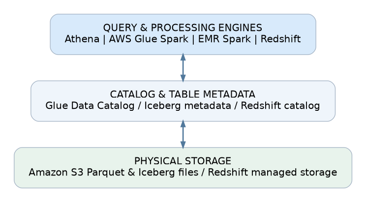
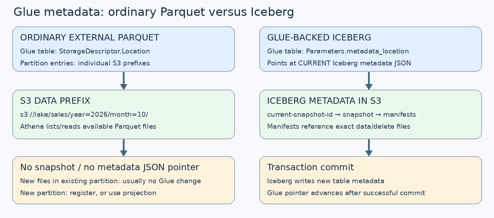
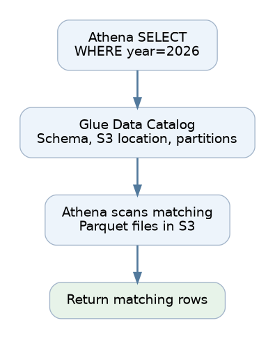
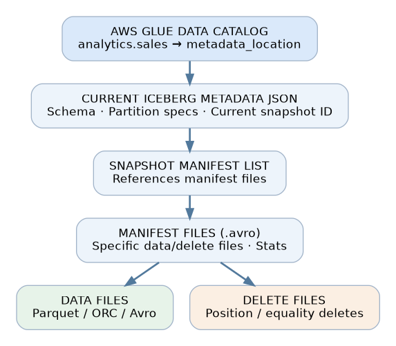
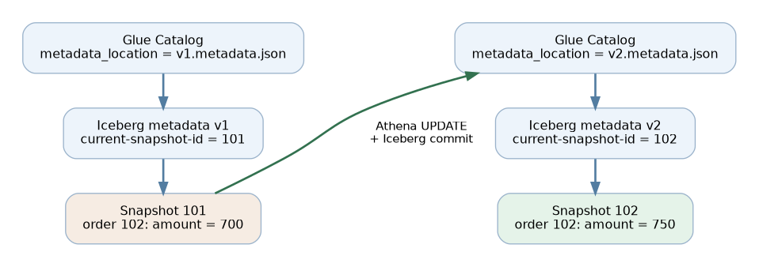
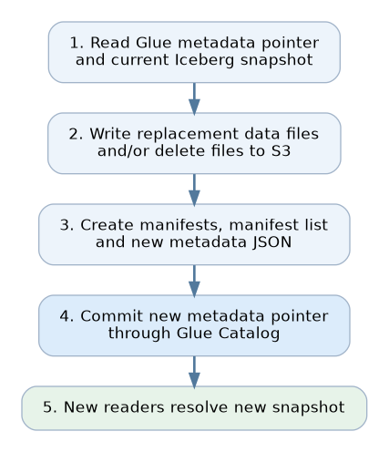
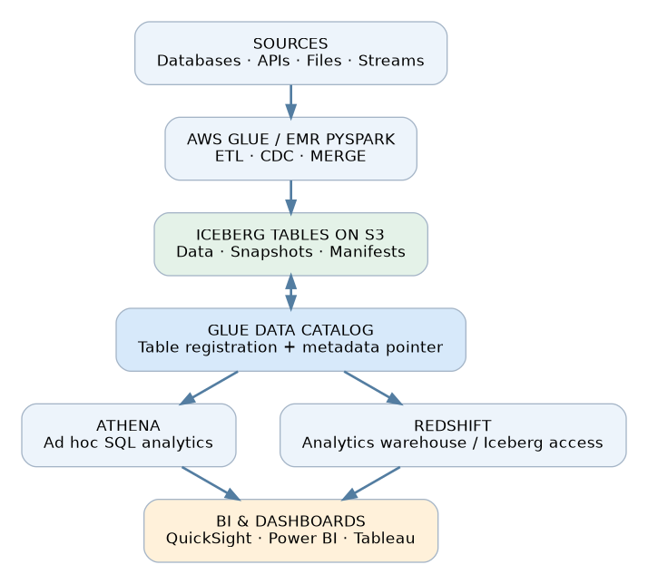

# AWS Glue Data Catalog, Apache Iceberg, Athena, Redshift & PySpark

**Technical reference — architecture, CRUD operations, catalog internals, and snapshot management**  

> **Core idea:** AWS Glue Data Catalog is a metadata service, not a row-level data store. Athena, Spark and Redshift execute reads and writes. For a Glue-backed **Iceberg** table, a successful write transaction commits a new Iceberg metadata version and automatically advances Glue's pointer (`metadata_location`) to that version.

## 1. Three layers of an AWS lakehouse



| Layer | Examples | Responsibility |
|---|---|---|
| Processing | Athena, AWS Glue PySpark, EMR Spark, Redshift | Executes SQL and transformation logic |
| Metadata | Glue Data Catalog, Iceberg metadata, Redshift system catalog | Identifies tables, schemas, files and/or current committed states |
| Storage | S3 and Redshift managed storage | Holds actual records and, for Iceberg, metadata files |

**Glue vs Iceberg:** Glue registers an Iceberg table and stores a reference to its current table metadata. Iceberg metadata, normally in S3, describes the actual current snapshot and its data/delete files.

## 2. CRUD support at a glance

| Engine / table type | INSERT | UPDATE | DELETE | How metadata is handled |
|---|---|---|---|---|
| Athena + regular external Parquet | Yes | No | No | Glue partitions may need registration |
| Athena + Iceberg | Yes | Yes | Yes | Iceberg commit advances Glue metadata pointer automatically |
| Glue PySpark + Parquet | Writes files | Rewrite affected data | Rewrite affected data | Manual/configured partition synchronization |
| Glue PySpark + Iceberg | Yes | Check runtime support | Check runtime support | Supported Iceberg writers commit through catalog |
| Redshift internal table | Yes | Yes | Yes | Redshift manages its own metadata/transactions |
| Redshift Spectrum + traditional external table | Supported `INSERT` | No | No | Supported INSERT can register new partitions |
| Redshift writable Iceberg table | Yes | Yes | Yes | Compatible Iceberg transactions and catalog commits |

**Version caveat:** Glue's documented Iceberg integration has specific runtime limitations; do not assume that a Spark SQL `UPDATE` supported upstream is supported in every AWS Glue version. Redshift's writable Iceberg capability is distinct from legacy read-oriented Spectrum tables.

## 3. Traditional Parquet with Glue Data Catalog

### 3.0 Glue WITHOUT Iceberg — what does Glue point to?

**For a conventional Glue-backed Parquet/CSV/ORC external table, Glue does not maintain an Iceberg `metadata_location` or a `current-snapshot-id`.** Instead, the Glue table definition has a **`StorageDescriptor.Location`**, normally pointing directly to the S3 root *prefix* for the table. It also holds column definitions, input/output formats, SerDe information, and `PartitionKeys`. For ordinary registered partitions, Glue maintains separate partition entries with values and often their own `StorageDescriptor.Location`.



**Illustrative regular Glue table (`aws glue get-table` — abbreviated):**

```json
{
  "Table": {
    "Name": "sales",
    "DatabaseName": "analytics",
    "TableType": "EXTERNAL_TABLE",
    "StorageDescriptor": {
      "Location": "s3://company-lake/sales/",
      "Columns": [{"Name": "order_id", "Type": "bigint"}, {"Name": "amount", "Type": "double"}],
      "InputFormat": "org.apache.hadoop.hive.ql.io.parquet.MapredParquetInputFormat",
      "SerdeInfo": {"SerializationLibrary": "org.apache.hadoop.hive.ql.io.parquet.serde.ParquetHiveSerDe"}
    },
    "PartitionKeys": [{"Name": "year", "Type": "string"}, {"Name": "month", "Type": "string"}]
  }
}
```

**Illustrative registered partition (`aws glue get-partitions` — abbreviated):**

```json
{
  "Partitions": [{
    "Values": ["2026", "10"],
    "StorageDescriptor": {
      "Location": "s3://company-lake/sales/year=2026/month=10/"
    }
  }]
}
```

**Athena read path without Iceberg:**

```text
Athena SELECT
  -> Glue GetTable (schema / table S3 root / partition keys)
  -> Glue GetPartitions (for registered partitions, if applicable)
  -> S3 LIST + READ the Parquet files under selected locations
  -> Return matching rows
```

Glue generally **does not track each individual Parquet filename**. Athena lists the S3 objects under the chosen data locations. If a writer replaces files within an **already registered** partition and leaves schema/partition locations unchanged, Glue normally requires **no metadata update**. Athena may observe the changed files on a subsequent query, but this is **not a transactional snapshot**: concurrent readers/writers can encounter inconsistent intermediate states if replacement is not safely coordinated.

For a **new partition**, register it with Glue (`ALTER TABLE ADD PARTITION`, crawler/API, appropriately configured writer), **or** use Athena partition projection where applicable. With partition projection, Athena computes partition paths from Glue table properties and does **not** need `GetPartitions` calls; note that other engines may not honor Athena's projection configuration.

| Question | Glue + ordinary Parquet | Glue + Iceberg |
|---|---|---|
| What is the primary S3 reference? | `StorageDescriptor.Location` (table/partition data prefixes) | `Parameters.metadata_location` (current Iceberg metadata JSON) |
| Is there a snapshot ID? | No | Yes, in Iceberg metadata JSON |
| Are individual data files tracked in table metadata? | No; S3 objects discovered at read | Yes, through manifest hierarchy |
| Does an append to an existing partition update Glue? | Usually not | Commit advances current Iceberg metadata pointer |
| What happens with a new partition? | Register partition or use projection | Iceberg tracks partition/file information in its metadata |
| What happens when rows are updated/deleted? | External rewrite and controlled publish; catalog may be unchanged | Iceberg commits new transactional state and pointer |

**CLI inspection:**

```bash
aws glue get-table --database-name analytics --name sales \
  --query 'Table.{Location:StorageDescriptor.Location,PartitionKeys:PartitionKeys,Parameters:Parameters}'

aws glue get-partitions --database-name analytics --table-name sales \
  --query 'Partitions[].{Values:Values,Location:StorageDescriptor.Location}'
```

The S3 **location is not a version pointer**: it remains the same while the underlying files may change. This is why a regular Glue table does not automatically receive Iceberg-style atomic visibility, snapshots, time travel or row-level CRUD.

Example files:

```text
s3://company-lake/sales/
  year=2026/
    month=10/
      part-001.parquet
      part-002.parquet
    month=11/
      part-003.parquet
```

Glue table definition (simplified):

```text
Database: analytics
Table: sales
Format: PARQUET
Columns: order_id BIGINT, customer_id BIGINT, amount DOUBLE
Partition keys: year STRING, month STRING
Location: s3://company-lake/sales/
```

### 3.1 Read flow



```sql
SELECT * FROM analytics.sales
WHERE year = '2026' AND month = '10';
```

Athena retrieves table/partition metadata from Glue, locates the applicable S3 prefixes and scans matching Parquet data. **Glue does not itself execute the SELECT or return the records.**

### 3.2 INSERT with PySpark

```python
df.write.mode("append") \
  .partitionBy("year", "month") \
  .parquet("s3://company-lake/sales/")
```

Spark creates files in S3. If files land in an **existing registered partition**, a Glue partition update normally is not needed. If a **new partition** appears, register it through an appropriate approach:

```sql
ALTER TABLE analytics.sales
ADD IF NOT EXISTS PARTITION (year='2026', month='12')
LOCATION 's3://company-lake/sales/year=2026/month=12/';
```

Alternatives: Glue crawlers, Glue APIs, `MSCK REPAIR TABLE` for compatible Hive layouts, configured Glue Catalog writers or partition projection in supported setups. **Simply writing files to S3 does not automatically update Glue.**

### 3.3 UPDATE or DELETE with plain Parquet

Plain Parquet is a **file format**, not an ACID table format. Athena does not offer regular row-level `UPDATE` / `DELETE` on traditional external Parquet tables. A Spark job can transform rows but must safely publish replacement files:

```python
from pyspark.sql.functions import col, when

# Data already read into df
updated_df = df.withColumn(
    "amount",
    when(col("order_id") == 102, 750)
    .otherwise(col("amount"))
)

remaining_df = df.filter(col("order_id") != 103)
```

Use a controlled stage-and-replace approach; avoid blindly overwriting a path being used as the input. **If the existing schema, table location and registered partitions stay the same, Glue Catalog typically does not change.** Glue is not a row-level index, and standard external-table metadata does not enumerate every Parquet file.

## 4. Iceberg metadata hierarchy — where snapshots live



| Object | Where it resides | What it contains |
|---|---|---|
| Glue table entry | AWS-managed regional Glue Catalog | Table registration and `metadata_location` |
| Iceberg table metadata JSON | Usually table's S3 `metadata/` directory | Schema, partition spec, snapshots, `current-snapshot-id` |
| Manifest list | S3 | Manifests belonging to a snapshot |
| Manifest files (Avro) | S3 | References to individual data/delete files; stats |
| Data and delete files | S3 | Records and supported row-deletion information |

Illustrative S3 layout:

```text
s3://lake/sales/
  data/
    file-001.parquet
    file-002.parquet
    delete-001.parquet
  metadata/
    v1.metadata.json
    v2.metadata.json
    v3.metadata.json
    snap-101.avro
    manifest-a.avro
    manifest-b.avro
```

Real filenames and layout vary by writer/version. Iceberg tracks **exact referenced files**, unlike a traditional partition directory listing.

## 5. The central clarification: why the Glue **pointer** is updated

**Yes — the Glue pointer update applies when Athena is using an Iceberg table registered in Glue.** Athena initiates and executes the write; the Iceberg writer constructs the new table state and commits it using the configured Glue-backed catalog; Glue persists the reference to the new metadata JSON.



### Before the UPDATE

Glue table properties (simplified):

```json
{
  "table_type": "ICEBERG",
  "metadata_location": "s3://lake/sales/metadata/v1.metadata.json"
}
```

Inside `v1.metadata.json` (simplified):

```json
{ "current-snapshot-id": 101 }
```

Snapshot 101 produces these logical rows:

| order_id | amount |
|---|---:|
| 101 | 500 |
| 102 | 700 |
| 103 | 900 |

### Athena UPDATE

```sql
UPDATE analytics.sales
SET amount = 750
WHERE order_id = 102;
```

On a successfully changed Athena Iceberg transaction, Athena writes appropriate change files (positional deletes and replacement data for row updates), Iceberg prepares the corresponding manifests, manifest list and metadata JSON, and the Glue-backed catalog commits the new metadata reference.

### After the successful commit

Glue table properties now point to:

```json
{
  "table_type": "ICEBERG",
  "metadata_location": "s3://lake/sales/metadata/v2.metadata.json"
}
```

The **new JSON**, not Glue directly, identifies the new snapshot:

```json
{ "current-snapshot-id": 102 }
```

The logical result is `order_id=102, amount=750`.

**Precisely what changes?**

| Layer | Before | After |
|---|---|---|
| Glue `metadata_location` | `v1.metadata.json` | `v2.metadata.json` |
| Iceberg JSON's `current-snapshot-id` | `101` | `102` |
| Logical table records | Amount 700 | Amount 750 |

**Glue points to an Iceberg metadata file; it does not directly point to snapshot 102.** This distinction explains why a new Athena or Spark reader can locate the latest committed state.

### Who does what?

| Step | Primary component |
|---|---|
| Parse/plan `UPDATE` and select affected rows | Athena |
| Write data/delete files | Athena Iceberg writer |
| Build manifests and table metadata | Iceberg writer |
| Coordinate atomic commit and check for conflicts | Iceberg catalog integration |
| Persist new `metadata_location` | AWS Glue Catalog |
| Resolve latest committed state in subsequent reads | Athena, Spark or compatible engine |

### Does a SELECT advance the Glue pointer?

**No.** `SELECT` reads existing Glue/Iceberg metadata and then data files. It creates neither a new Iceberg snapshot nor a catalog pointer commit. A no-op DML statement also need not result in a new committed state.

## 6. Iceberg commit flow and concurrency



1. Resolve the current Glue catalog `metadata_location`.
2. Read Iceberg metadata and plan changes.
3. Write new data/delete files and produce manifests and a new metadata JSON.
4. Attempt an atomic catalog commit advancing the `metadata_location`.
5. On success, new readers see the new snapshot. On commit conflict, the writer may retry or fail depending on implementation/operation.

The **file writes alone do not complete the transaction**. The catalog commit publishes the new table state. This is why you should **not** use plain `df.write.parquet(...)` directly in an existing Iceberg table's data directory: those files are not automatically referenced by its committed snapshot.

## 7. Iceberg UPDATE strategies: COW and MOR

| Strategy | Internal action | Tradeoff |
|---|---|---|
| Copy-on-write (COW) | Rewrite affected data files and commit references to replacements | More write I/O; potentially simpler reads |
| Merge-on-read (MOR) | Add delete information and replacement data; readers combine both | Usually less immediate rewrite; accumulated delete files may slow reads |

Athena Iceberg `UPDATE`, `DELETE` and `MERGE` use **merge-on-read with positional deletes** for row-level operations, regardless of a requested copy-on-write setting. Some optimizations can remove entire files through metadata without writing per-row deletes. Other Iceberg engines may support different strategies.

## 8. Athena Iceberg CRUD and introspection

Example Athena Iceberg table:

```sql
CREATE TABLE analytics.sales_iceberg (
  order_id BIGINT,
  customer_id BIGINT,
  amount DOUBLE,
  order_date DATE
)
PARTITIONED BY (month(order_date))
LOCATION 's3://company-lake/iceberg/sales/'
TBLPROPERTIES ('table_type'='ICEBERG', 'format'='parquet');
```

```sql
INSERT INTO analytics.sales_iceberg
VALUES (101, 1001, 500.0, DATE '2026-10-26');

UPDATE analytics.sales_iceberg
SET amount=550 WHERE order_id=101;

DELETE FROM analytics.sales_iceberg
WHERE order_id=101;
```

Each successfully committed table change creates a new Iceberg table state and advances Glue's metadata pointer. **You do not manually add Iceberg partitions to Glue.**

Inspect Iceberg system tables in Athena:

```sql
SELECT * FROM "analytics"."sales_iceberg$snapshots";
SELECT * FROM "analytics"."sales_iceberg$history";
SELECT * FROM "analytics"."sales_iceberg$files";
SELECT * FROM "analytics"."sales_iceberg$manifests";
SELECT * FROM "analytics"."sales_iceberg$partitions";
```

## 9. Glue PySpark + Iceberg

For a compatible Glue runtime, enable Iceberg using `--datalake-formats iceberg` and configure Spark (each line is a separate Spark setting):

```properties
spark.sql.extensions=org.apache.iceberg.spark.extensions.IcebergSparkSessionExtensions
spark.sql.catalog.glue_catalog=org.apache.iceberg.spark.SparkCatalog
spark.sql.catalog.glue_catalog.catalog-impl=org.apache.iceberg.aws.glue.GlueCatalog
spark.sql.catalog.glue_catalog.warehouse=s3://company-lake/iceberg/
spark.sql.catalog.glue_catalog.io-impl=org.apache.iceberg.aws.s3.S3FileIO
```

Using an Iceberg-aware Spark writer:

```python
# Append to an existing Iceberg table
df.writeTo("glue_catalog.analytics.sales_iceberg").append()
```

A supported upsert pattern is `MERGE INTO`:

```python
updates_df.createOrReplaceTempView("sales_updates")

spark.sql("""
MERGE INTO glue_catalog.analytics.sales_iceberg AS t
USING sales_updates AS s
ON t.order_id = s.order_id
WHEN MATCHED THEN UPDATE SET t.amount = s.amount
WHEN NOT MATCHED THEN
  INSERT (order_id, amount) VALUES (s.order_id, s.amount)
""")
```

Support depends on the Glue runtime, Iceberg version and permissions. Spark's Iceberg writer will generate new metadata and commit the Glue pointer when using `GlueCatalog`. This is **not** manual Hive partition registration.

## 10. Redshift: distinguish three different table types

### 10.1 Redshift internal tables

```sql
CREATE TABLE public.sales (
  order_id BIGINT,
  amount DECIMAL(12,2)
);

UPDATE public.sales SET amount=750 WHERE order_id=102;
DELETE FROM public.sales WHERE order_id=103;
```

Data and transaction metadata are managed by Redshift. Glue Catalog is **not necessary** for ordinary internal-table CRUD.

### 10.2 Redshift Spectrum traditional external tables

```sql
CREATE EXTERNAL SCHEMA spectrum
FROM DATA CATALOG
DATABASE 'analytics'
IAM_ROLE 'arn:aws:iam::123456789012:role/RedshiftRole';

SELECT * FROM spectrum.sales;
```

Supported INSERT into an existing external table can write S3 data and register newly created partitions automatically:

```sql
INSERT INTO spectrum.sales
SELECT * FROM public.sales;
```

Traditional Spectrum external tables do **not** support direct UPDATE or DELETE.

### 10.3 Redshift writable Iceberg tables

With the supported Redshift Iceberg write feature, compatible Glue-registered Iceberg tables support DML such as:

```sql
UPDATE awsdatacatalog.analytics.sales_iceberg
SET amount=750 WHERE order_id=102;

DELETE FROM awsdatacatalog.analytics.sales_iceberg
WHERE order_id=103;
```

Such writes update Iceberg files/metadata and commit the new state through the supported Glue-backed catalog. Feature support, permissions and table compatibility requirements apply. **Do not generalize this to legacy Spectrum external Parquet tables.**

## 11. Where to inspect Glue vs Iceberg metadata

### AWS Glue API / CLI

```bash
aws glue get-table \
  --database-name analytics \
  --name sales_iceberg
```

Illustrative subset of a Glue table response (actual fields vary):

```json
{
  "Table": {
    "DatabaseName": "analytics",
    "Name": "sales_iceberg",
    "TableType": "EXTERNAL_TABLE",
    "Parameters": {
      "table_type": "ICEBERG",
      "metadata_location": "s3://lake/sales/metadata/v3.metadata.json"
    }
  }
}
```

### S3 Iceberg metadata file

Illustrative subset only (not a complete valid Iceberg JSON):

```json
{
  "format-version": 2,
  "location": "s3://lake/sales/",
  "current-snapshot-id": 2003,
  "snapshots": [
    {"snapshot-id": 2002, "manifest-list": "s3://lake/sales/metadata/snap-2002.avro"},
    {"snapshot-id": 2003, "manifest-list": "s3://lake/sales/metadata/snap-2003.avro"}
  ]
}
```

Glue Catalog is an **AWS-managed metadata service**, not a directory you can browse in S3. Iceberg metadata files, on the other hand, normally live in the table's S3 location.

## 12. Do you need Glue for Spark + Iceberg?

**No.** Iceberg requires a suitable catalog implementation, but this need not be AWS Glue. Options include Glue, Hive Metastore, Hadoop, JDBC and REST catalogs, depending on your environment. Spark can use Iceberg on EMR, EC2, Kubernetes and elsewhere without Glue ETL jobs.

Important distinctions:

- **Glue Data Catalog != Glue ETL.** You can use Glue as a catalog without running Glue Spark jobs.
- **Iceberg != Glue.** Iceberg can use another catalog.
- **Athena Iceberg** is designed around its supported Glue-backed catalog integration.
- For a shared AWS lakehouse across Athena, Spark and Redshift, **Glue Catalog is often the simplest common catalog choice**.

## 13. Athena and PySpark accessing the same table

```text
Initial:    Glue → v1.metadata.json → snapshot 101
Spark INSERT and commit
Next:       Glue → v2.metadata.json → snapshot 102
Athena SELECT sees committed snapshot 102
Athena UPDATE and commit
Next:       Glue → v3.metadata.json → snapshot 103
Spark SELECT (refresh/expiration as needed) sees snapshot 103
```

A long-running Spark session may cache table metadata; refresh/expiration may be necessary to observe the newest snapshot. Concurrent writers rely on Iceberg's catalog-based commit control; conflicting commits may need retries.

## 14. Recommended AWS BI lakehouse architecture



Use Spark/Glue/EMR for batch transformations and CDC/upserts, Iceberg on S3 for transactional lakehouse tables, Glue Data Catalog as shared table registration, and Athena or Redshift for analytics and BI. Athena and Redshift read the catalog metadata directly; Glue does not sit in the data path as a query proxy.

Operational considerations: file compaction, accumulating delete files, snapshot expiration, schema changes, concurrent writes, query-cost management, and precomputed BI aggregates.

## 15. Final behavior matrix

| Operation | Change in S3? | Glue change? | Iceberg snapshot? |
|---|---|---|---|
| Append Parquet to existing registered partition | Yes | Usually no | N/A |
| Add new Parquet partition | Yes | Register if needed | N/A |
| Rewrite existing Parquet files | Yes | Usually no if table/partitions unchanged | N/A |
| Athena Iceberg SELECT | No | No | No |
| Athena Iceberg INSERT / UPDATE / DELETE | Yes or metadata-only optimization | **Advance Iceberg metadata pointer** on changed commit | Yes |
| Spark Iceberg append / supported MERGE | Yes | **Advance pointer** on changed commit | Yes |
| Redshift internal UPDATE | Redshift-managed storage | Not applicable | N/A |
| Redshift Spectrum traditional Parquet INSERT | Yes | New partitions automatically registered when needed/supported | N/A |
| Redshift writable Iceberg DML | Yes or appropriate metadata changes | **Advance pointer** on changed commit | Yes |

### Five key takeaways

1. Glue Data Catalog holds table metadata; query engines perform CRUD.
2. Ordinary Parquet is a file format, while Iceberg is a transactional table format that frequently uses Parquet as its data files.
3. **Without Iceberg**, Glue points to table/partition S3 data prefixes via `StorageDescriptor.Location` and has no snapshot pointer. **With Iceberg**, Glue's `metadata_location` points to the current Iceberg metadata JSON, which identifies the current snapshot.
4. Athena or Spark **automatically advances that pointer on a successful Iceberg commit**; a SELECT does not.
5. Redshift's behavior depends on whether you use internal tables, traditional Spectrum external tables or writable Iceberg tables.

## 16. Official references

- [AWS Glue Data Catalog](https://docs.aws.amazon.com/glue/latest/dg/catalog-and-crawler.html)
- [Glue Table API (StorageDescriptor, PartitionKeys)](https://docs.aws.amazon.com/glue/latest/webapi/API_Table.html)
- [Athena partition projection](https://docs.aws.amazon.com/athena/latest/ug/partition-projection.html)
- [AWS Glue: using Apache Iceberg](https://docs.aws.amazon.com/glue/latest/dg/aws-glue-programming-etl-format-iceberg.html)
- [Athena: updating Iceberg table data](https://docs.aws.amazon.com/athena/latest/ug/querying-iceberg-updating-iceberg-table-data.html)
- [Athena: querying Iceberg tables](https://docs.aws.amazon.com/athena/latest/ug/querying-iceberg.html)
- [Redshift: Iceberg writes](https://docs.aws.amazon.com/redshift/latest/dg/iceberg-writes.html)
- [Redshift: external-table INSERT](https://docs.aws.amazon.com/redshift/latest/dg/r_INSERT_external_table.html)
- [Redshift Spectrum considerations](https://docs.aws.amazon.com/redshift/latest/dg/c-spectrum-considerations.html)

*Diagrams are explanatory illustrations; sample IDs, S3 paths, metadata JSON and rows are not actual production outputs.*
